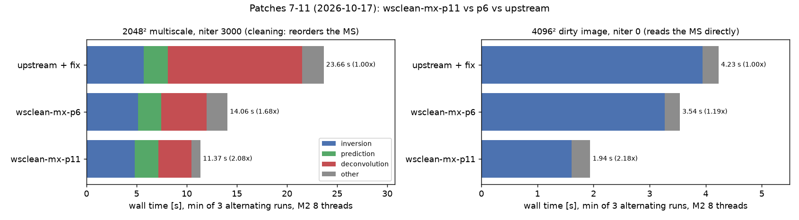
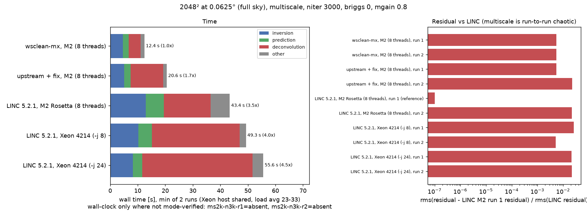

# wsclean-mx


WSClean optimized for macOS on Apple Silicon.

**Current release: [0.1.1](https://github.com/peijin94/wsclean-mx/releases/tag/v0.1.1).**
The executable is now **`wsclean-mx`**, with a separately reported MX version and
upstream WSClean 3.7 identity. The Homebrew release is CPU-only. See the
[versioned installation guide](https://github.com/peijin94/wsclean-mx/blob/v0.1.1/install.md)
and [release validation/limitations](https://github.com/peijin94/wsclean-mx/blob/v0.1.1/docs/release-0.1.1.md).
This default branch retains the historical implementation and measurements below;
use the release tag for the current source. No experimental implementation merge
is implied by the packaging update.

wsclean-mx is a small patch set on top of upstream
[WSClean](https://gitlab.com/aroffringa/wsclean), pinned to the exact commit
that ships in the LINC 5.2.1 container (`2d5c1ed8`, WSClean 3.7). It builds
natively for arm64, moves serial FFT and deconvolution work onto all cores,
and removes I/O and locking bottlenecks.
It also fixes an upstream bug that corrupts 2048² images on macOS. Dirty/PSF
products agree with the fixed upstream reference at float32 rounding
(~1e-7 relative RMS). On real LOFAR telescope data (the 3C196 CI fixture —
geometrically phased to 3C196 but uncalibrated, so a pipeline-equivalence
check, not source photometry) the multiscale cleaned products agree at the
same floor in every measured quantity; on the
noise-dominated quiet-Sun snapshot they sit inside the reference's own
chaotic spread (50-rerun family, max and p95 criteria). Details:
[docs/science-gates.md](docs/science-gates.md) and
[CHANGELOG.md](CHANGELOG.md).

On a fanless MacBook Air M2 (16 GB), a full-sky 2048² multiscale clean
(niter 3000) of one OVRO-LWA snapshot takes:

| Build | Wall time |
|-------|-----------|
| **wsclean-mx** (native arm64, CPU patch stack) | **11.4 s** |
| upstream WSClean (native arm64, with the padding fix) | 23.7 s |
| LINC 5.2.1 container (Apple `container`, Rosetta)\* | 43.4 s |
| LINC 5.2.1 on Linux, 2× Xeon Silver 4214, `-j 8`\* | 49.3 s |

\*Measured 2026-10-13, when wsclean-mx (patches 1–6) took 12.4 s and
upstream 20.6 s; the Mac is memory-tight, so sessions differ by ~15%.
A 4096² dirty image takes 1.9 s with wsclean-mx vs 4.2 s with upstream.




Full results, plots and methodology: [benchmark.md](benchmark.md). Progress
log: [issue #1](https://github.com/peijin94/wsclean-mx/issues/1).

The current development plan is [docs/development-plan.md](docs/development-plan.md).
The [2026-10-17 audit](docs/audit-2026-10-17.md) records fresh benchmarks,
regression coverage, and initial correctness/test gaps. The
[CPU correctness continuation](docs/continuation-2026-10-17.md) covers selection-safe
readers, allocation portability, time metadata and the follow-up gates. This is a development
patch set, not a claim that every WSClean observing mode is validated.
An earlier suspected dirty-imaging slowdown did **not** survive controlled
measurement: interleaved A/A and single-thread sweeps put the candidate within
0.3–0.5% of the baseline with equal retired instructions, per
[docs/throttle-validation-2026-10-18.md](docs/throttle-validation-2026-10-18.md).

## The patches

The patch set lives in `patches/mx/<repo>/`, one directory per library:

| Patch | What it does | Effect |
|-------|--------------|--------|
| schaapcommon/0001 | Resampler: multithreaded ducc0 FFT instead of single-threaded FFTW | inversion 1.5×, prediction 1.8× at 4096² |
| schaapcommon/0002 | Convolve: multithreaded ducc0 FFT instead of FFTW | multiscale deconvolution ~2× |
| aocommon/0001 | Median/MAD: radix-histogram select instead of a full `nth_element` | MAD of 4096² image 300 → 65 ms |
| wsclean/0001 | `WGridder::RealImage` pads with 0 instead of NaN | fixes corrupt images under Apple clang `-ffast-math` |
| radler/0001 | SubMinorLoop: multithreaded PSF subtraction and peak search | Högbom deconvolution 6.2 → 2.4 s at 4096² |
| radler/0002, schaapcommon/0003 | Multiscale: one residual FFT per peak search, cached scale-kernel FFTs | fewer FFTs per multiscale iteration |
| radler/0003 | Multiscale: reuse the scale-convolved residual, cache per-scale PSF transforms | deconvolution 4.18 → 3.64 s at 2048² |
| schaapcommon/0004 | ducc0 gridder: spin lock per grid row instead of `std::mutex` | lock time ~5× lower |
| wsclean/0002 | Read measurement set columns in blocks of rows (direct reads) | 4096² dirty image 1.70× |
| wsclean/0003 | Same, during reordering (cleaning runs) | reordering 2.3× |
| radler/0004 | Peak finder: vectorized row maximum skips rows | peak search 8×, deconvolution 1.12× |
| radler/0005 | Allocate multiscale peak scratch only for RMS-weighted searches | removes one unused full-image allocation per unweighted scale search; no promised wall-time gain |
| wsclean/0004 | Preserve selected-row reads; validate full data/flag/weight shapes | avoids speculative-read failures and unsafe malformed-array extraction |
| aocommon/0002 | Portable fundamental-alignment allocation in MultiArray | fixes invalid-alignment `std::bad_alloc` on macOS; retains over-aligned allocation |
| wsclean/0005 | Convert in-memory provider start time from seconds to MJD days | correct FITS observation dates; row metadata remains seconds |

The upstream padding bug: `WGridder::RealImage()` fills image padding with
NaN, but its source file is compiled with `-ffast-math`, and Apple clang
drops the fill. The padding is then uninitialized memory, so with the default
small inversion many 2048² dirty images are garbage. GCC builds (LINC) are
not affected. Details are in [benchmark.md](benchmark.md).

## Install

Apple Silicon Mac, [Homebrew](https://brew.sh):

```bash
brew tap peijin94/wsclean-mx
brew tap ska-sa/tap
brew install ska-sa/tap/casacore-data
brew install peijin94/wsclean-mx/wsclean-mx
wsclean-mx -version
```

## Building

For the released source and current commands, use the
[0.1.1 source-build guide](https://github.com/peijin94/wsclean-mx/blob/v0.1.1/install.md).
Check out `v0.1.1` explicitly; this branch's historical developer tree is not the
0.1.1 release source. The installed formula pins an immutable reviewed source
commit and its actual archive checksum.

## Repository layout

```
upstream/wsclean/      git submodule, pristine upstream at 2d5c1ed8 (never edited)
patches/mx/<repo>/     the wsclean-mx patch set (source of truth)
patches/build/         macOS build fixes, applied to both reference and mx builds
scripts/               dependency, reference and mx builds; dev-tree tools
bench/                 benchmark and comparison harness
docs/bench/            benchmark figures
benchmark.md           benchmark results
mem.md, notes.md       project notes and design plan
```

Development happens in `work/<repo>` git trees (branch `mx`), created from
the patch set by `scripts/mx_tree.sh init`. After committing there,
`scripts/mx_tree.sh export <repo>` writes the patches back to `patches/mx/`.

## Benchmarking

```bash
uv venv .venv && uv pip install --python .venv/bin/python -r bench/requirements.txt
container system start
container image pull --platform linux/amd64 docker.io/astronrd/linc:5.2.1

bench/run.sh mx mytag <wsclean args>              # one run -> bench/out/mytag/mx/
REPS=2 COOL=30 bench/ab.sh mytag mx,upstream,linc <wsclean args>   # alternating A/B
REPS=2 COOL=30 bench/aa.sh snapl snapl2 nullctl <wsclean args>     # A/A null control
.venv/bin/python bench/compare_fits.py bench/out/mytag-r1/linc bench/out/mytag-r1/mx
.venv/bin/python bench/plot_report.py             # regenerate docs/bench/*.png
```

Variants are `mx`, `upstream`, `linc` (the LINC container under Rosetta), or
any frozen build in `bench/bin/<name>/` (`bench/snapshot.sh`). `run.sh`
adds `-no-update-model-required` and rejects known MS-writing and output-path
overrides. Keep benchmark MSs read-only as an independent safeguard; this is
not a sandbox for arbitrary WSClean arguments. Existing run and snapshot
names are refused rather than deleted. A/B runs reverse variant order on
alternate repetitions and fail on missing/malformed timings.

Every run also records retired instructions and cycles when the platform's
`time` command provides them (`bench/out/<tag>/<variant>/counters.txt`), and
`ab.sh` writes the comparison's mode assessment to `bench/out/<tag>-ab.mode.txt`.
**Do not read a wall-clock difference as a patch effect until that file says
`comparable`:** similar instruction counts with much higher cycle counts is a
host stall/scheduling mode that has hit identical binaries alike. `bench/aa.sh`
verifies that two snapshots are byte-identical and runs the same A/B machinery on
them as a null control; use it to size the host's own spread next to any claimed
improvement. The verdict is printed before the ratio table and is also
`unclassified` when counters are missing, incomplete or invalid, when a variant's
own repeats span several cycle levels, when instruction counts differ by more
than 20% (different work, or counters measuring different things), or for the
`linc` container, whose counters describe the host container CLI rather than the
guest. `bench/plot_report.py` still labels historical wall ratios without reading
mode files; treat its figures accordingly until that is updated.

Comparisons follow three tiers: bitwise for operation-preserving incremental
changes at `-j 1`, ULP, and scientific metrics against the fixed native upstream
reference. Multithreaded cleaning is not deterministic; reference rerun and
perturbation spread must be considered together with source-level science gates.

## Regression tests

```bash
scripts/test.sh build-mx
```

This runs Python harness/FITS tests, rebuilds the selected mx binary, and runs
linked-production convolution/resampler, median, peak, MS column-block,
allocation and time-contract checks. It rejects mismatched CMake source mappings.
Synthetic unit fixtures are separate from the real MS benchmarks.
Compiler output may include upstream's expected non-AVX warning on arm64.

Science acceptance is separate and measured at source level, not by pixel RMS:
`bench/compare_sources.py --candidate DIR REFERENCE_DIR ...` compares flux, peak
position, size and matched-source quantities against the reference's own rerun
envelope. Results and the predeclared decision rule are in
[docs/science-gates.md](docs/science-gates.md) — dirty/PSF pass, the multiscale
cleaned products pass against a ten-rerun envelope, patch 12 is neutral, and on
real LOFAR telescope data (3C196 fixture, uncalibrated — pipeline equivalence,
not photometry) the stack agrees
with the fixed reference to float32 rounding.

The upstream unit/integration suites are separate and require their test data.
The initial audit's seven allocation failures are repaired, together with the
in-memory date defect they exposed. The continuation report gives current native
counts, reader fixtures, remaining skips and exact commands. Zero tests from
`ctest -N` is not a successful validation; passing native tests does not settle
the broader multiscale scientific-acceptance question.

## Roadmap

The current patches are CPU-only. Planned next steps, described in
`notes.md`: a Metal GPU gridding backend and benchmarks on larger
measurement sets where gridding dominates. First complete the remaining science
and reproducibility gates in [the development plan](docs/development-plan.md).
Accelerate's vDSP 2D FFT was
measured and is slower than ducc0's multithreaded FFT, so it is not used.

## License

wsclean-mx is a modified version of WSClean and is distributed under the
[GNU General Public License v3](LICENSE), like WSClean itself. Each patch
keeps the license of the upstream file it changes: the radler patches are
LGPL-3.0-only ([LICENSE.LESSER](LICENSE.LESSER) together with
[LICENSE](LICENSE)), the others GPL-3.0. Original files in this repository
are GPL-3.0-or-later.

[NOTICE.md](NOTICE.md) has the upstream copyrights and pinned sources, a
dated list of every modification (GPLv3 section 5), and what to include when
distributing a binary (section 6: the Corresponding Source is this repository
at the build commit plus the pinned upstream sources).

Copyright (C) 2026 Peijin Zhang. WSClean is Copyright (C) André Offringa and
contributors; aocommon, schaapcommon and radler are Copyright (C) ASTRON.
This program comes with ABSOLUTELY NO WARRANTY.
