# wsclean-mx benchmarks

Benchmark results for wsclean-mx against upstream WSClean and the LINC
container. Progress is tracked in
[issue #1](https://github.com/peijin94/wsclean-mx/issues/1); raw notes are in
`mem.md`. All figures are generated by `bench/plot_report.py` from runs in
`bench/out/` (not committed).

Fresh validation, existing-stack reruns and the conditional-scratch experiment
are recorded separately in [docs/audit-2026-10-17.md](docs/audit-2026-10-17.md).
That report states failed gates as well as passing ones; it does not replace
the historical measurements below.

## What is compared

**wsclean-mx** is WSClean optimized for macOS on Apple Silicon. It is a patch
set (`patches/mx/`) on top of the exact upstream WSClean commit that ships in
the LINC 5.2.1 container (`2d5c1ed8`, "WSClean 3.7, v3.7-79-g2d5c1ed8"), with
the same pinned aocommon, schaapcommon and radler. It builds natively for
arm64 with Apple clang (`-O3 -march=native`) against casacore 3.8.2. The
patches move serial FFT and deconvolution work onto all cores, and fix one
upstream bug that corrupts images on macOS. Dirty/PSF products agree closely on
the tested snapshot.
Historical cleaned-image comparisons below are workload-specific: the fresh
audit found percent-level multiscale differences, not a blanket equivalence gate.

**wsclean-mx-p6** (`mx-p6` in the plots) is the frozen build of wsclean-mx
with the then-current patches, from commit
[`f2c208a`](https://github.com/peijin94/wsclean-mx/commit/f2c208a73cfb9f445f871e318f6e51fa35176fab):

| # | Patch | Repo |
|---|-------|------|
| 1 | Resampler: multithreaded ducc0 FFT instead of single-threaded FFTW | schaapcommon/0001 |
| 3 | Convolve: multithreaded ducc0 r2c/c2r instead of the FFTW row/column composite | schaapcommon/0002 |
| 4 | Median/MAD: radix-histogram select instead of a full `nth_element` | aocommon/0001 |
| fix | `WGridder::RealImage` pads with 0 instead of NaN (bug below) | wsclean/0001 |
| 5 | SubMinorLoop: multithreaded PSF subtraction and peak search | radler/0001 |
| 6 | Multiscale: transform the residual once per peak search, cache scale-kernel FFTs | radler/0002, schaapcommon/0003 |

**wsclean-mx-p11** (`mx-p11`) adds patches 7–11, from commit
[`a6f5381`](https://github.com/peijin94/wsclean-mx/commit/a6f5381cf56180008d592a6edb21f10efb083adc):

| # | Patch | Repo |
|---|-------|------|
| 7 | Multiscale: reuse the scale-convolved residual from the peak search, cache per-scale PSF kernel transforms | radler/0003 |
| 8 | ducc0 wgridder: cache-line spin lock per grid row instead of `std::mutex` | schaapcommon/0004 |
| 9 | ContiguousMSReader: read measurement set columns in blocks of rows | wsclean/0002 |
| 10 | MSRowProvider (reordering): read measurement set columns in blocks of rows | wsclean/0003 |
| 11 | `peak_finder::Simple`: skip rows that cannot raise the peak (vectorized row maximum) | radler/0004 |

Patch 2 (vForce `sincos` in ducc0) measured within noise and is not applied.
Earlier snapshots in the plots: `mx-p1` = patch 1
([`a55c6ff`](https://github.com/peijin94/wsclean-mx/commit/a55c6ffb39e408bf5d2fb87886ce91ad61441c45)),
`mx-p3` = patches 1+3+4+fix
([`c27e6ff`](https://github.com/peijin94/wsclean-mx/commit/c27e6ffac24c0c6eed2a32b507076d15106a59b7)).

**Apple container LINC (host WSClean)** is the official
`docker.io/astronrd/linc:5.2.1` x86_64 image, run on the Mac with Apple
`container` 1.5.0 under Rosetta (`--platform linux/amd64 --rosetta`, 8 CPUs,
12 GB). It contains the same upstream WSClean source built with GCC for
x86_64, so it is the scientific reference: what an LWA pipeline user runs
today. It is never bitwise identical to a native build (different compiler
and architecture), only equal at the scientific tier.

Other variants:

- **upstream**: the pinned upstream, built natively on the Mac with the same
  CMake configuration as wsclean-mx, no patches.
- **upstream-fix** (`upstream + fix`): upstream plus only the padding fix.
  It is the baseline for timing comparisons, because plain upstream produces
  corrupt 2048² images on macOS.
- **Linux native**: the same `astronrd/linc:5.2.1` image under docker on a
  Linux x86_64 server (no emulation).

## Machines and data

| Machine | CPU | Memory | Notes |
|---------|-----|--------|-------|
| MacBook Air (Mac14,2) | Apple M2, 4 performance + 4 efficiency cores | 16 GB LPDDR5 unified memory (shared by CPU and GPU) | fanless, throttles; macOS 27.0.1, Apple clang 21.0.0 |
| inti (Linux) | 2× Intel Xeon Silver 4214 @ 2.2 GHz, 24 cores / 48 threads, 2 NUMA nodes | 384 GB DDR4 (12 × 32 GB, 6 channels per socket; 376 GB usable) | shared host, docker |

Memory conditions during the runs:

- The Mac is memory-tight. Desktop apps stayed open during benchmarks, and
  12–14 GB of swap was in use; this adds noise to Mac timings. The LINC
  container VM is capped at 12 GB (WSClean inside reports 11.8 GB).
- inti had about 308 GB available, so memory was never a constraint there.
- Peak WSClean memory for 2048² multiscale niter 3000: wsclean-mx-p6
  1.18 GB, upstream-fix 1.5–1.6 GB (resident set size on the Mac). 16 GB
  limits practical image sizes on the Mac to about 8192².

Test data: `20260906_170040_50MHz.ms`, one 10 s OVRO-LWA all-sky integration,
352 antennas, 192 channels × 23.9 kHz at 50.1 MHz, Stokes I. The MS is kept
read-only and every run uses `-no-update-model-required`.

Method: `bench/run.sh` runs one variant; `bench/ab.sh` alternates variants
with cooldowns and reports the minimum over repeats. Images are compared with
`bench/compare_fits.py` as rms(difference) / rms(reference). Bitwise checks
use `-j 1`, since multithreaded runs are not deterministic.

## Results

All results are for WSClean 3.7 (`2d5c1ed8`). Unless stated, runs use
briggs 0, mgain 0.8 and all threads. Results from 2026-10-17 come first,
then 2026-10-13.

### Patches 7–11 (2026-10-17)

Commit [`a6f5381`](https://github.com/peijin94/wsclean-mx/commit/a6f5381cf56180008d592a6edb21f10efb083adc).
M2, 8 threads, min of 3 alternating runs (`bench/ab.sh`, 20 s cooldowns).

| Run | upstream-fix | mx-p6 | mx-p11 |
|-----|--------------|-------|--------|
| 2048² @ 0.0625° multiscale niter 3000, wall | 23.66 s | 14.06 s (1.68×) | **11.37 s (2.08×)** |
| same, inversion | 5.68 s | 5.15 s | 4.80 s |
| same, deconvolution | 13.40 s | 4.52 s | **3.30 s (4.06×)** |
| 4096² @ 0.03125° dirty (niter 0), wall | 4.23 s | 3.54 s (1.19×) | **1.94 s (2.18×)** |
| same, inversion | 3.94 s | 3.27 s | **1.61 s (2.45×)** |

Each patch is bitwise identical to its predecessor at `-j 1`. Multithreaded
2048² residual rms: upstream-fix 24.641–24.646, mx-p11 24.636–24.657 µJy;
mx-p11 vs upstream-fix differs by the same amount as two upstream-fix runs
(restored image 3.0e-3 vs 2.4e-3 relative rms).

What each patch found and gained (single-patch A/B, min of 3):

- **Patch 7**: per multiscale iteration, the residual was convolved with every
  scale for the peak search and then again for the subtraction, and the
  twice-convolved PSF kernel was re-transformed each time. Deconvolution
  4.18 → 3.64 s at 2048².
- **Patch 8**: the gridder takes about 38 grid-row locks per tile flush.
  Contended `std::mutex` parks threads in the kernel on macOS
  (`__psynch_mutexwait`); the spin lock cut lock samples 3758 → 770.
  4096² inversion 3.45 → 3.30 s.
- **Patch 9**: every column of the test MS (DATA, FLAG, WEIGHT, UVW) is an
  indirect array in one StandardStMan file behind one 64 KB buffer. Reading
  row by row and switching columns refills the buffer on every access:
  `bench/micro/ms_read.cpp` reads the MS in 0.90 s row by row vs 0.09 s in
  1024-row blocks per column. 4096² dirty wall 3.58 → 2.11 s (1.70×). It applies
  when WSClean reads the MS directly (no deconvolution).
- **Patch 10**: the same fix for reordering, which cleaning runs use. The
  reorder pass itself is 2.3× faster (512² niter 0 with `-reorder`: wall 1.85 →
  1.12 s); about 0.7 s at 2048² multiscale. Blocks fall back to one row when
  spectral windows differ in size, since casacore takes the cell shape of a
  block from its first row.
- **Patch 11**: radler's scalar peak finder does not vectorize, because it
  tracks the peak index inside the loop (the AVX version is x86 only).
  A vectorized row maximum skips rows that cannot hold a new peak: 8× faster on
  a 2048² image (`bench/micro/peak_simple.cpp`, 800 randomized bitwise checks).
  Deconvolution 4.39 → 3.90 s.

Tried and dropped: replacing ducc0's FFT with Accelerate's
`vDSP_fft2d_zrip` (`bench/micro/fft2d_vdsp.cpp`). At 2048², ducc0 r2c+c2r takes
17.9 ms on one thread and 4.7 ms on 8; vDSP takes 51 ms single-threaded.

Remaining profile at 2048² multiscale (main thread): gridding/degridding
kernels and FFTs, which are already multithreaded, about 0.4 s of reordered
temporary file I/O, and serial FITS writing.

### Cross-platform: 2048² multiscale, niter 3000

Commit [`1a67f8a`](https://github.com/peijin94/wsclean-mx/commit/1a67f8a78a94875ae19f60b10690c279595d8804).
`-size 2048 2048 -scale 0.0625 -multiscale -niter 3000` (full sky). Min of 2.

| Configuration | Memory | Wall | Inversion | Prediction | Deconvolution |
|---------------|--------|------|-----------|------------|---------------|
| wsclean-mx-p6, M2 | 16 GB | **12.4 s** | 4.6 s | 2.1 s | 4.4 s |
| upstream-fix, M2 | 16 GB | 20.6 s | 5.1 s | 2.4 s | 11.8 s |
| LINC, Apple container on M2 (Rosetta) | 12 GB VM | 43.4 s | 12.9 s | 6.6 s | 17.0 s |
| LINC, Linux native on Xeon, `-j 8` | 384 GB | 49.3 s | 10.2 s | 4.9 s | 31.9 s |
| LINC, Linux native on Xeon, `-j 24` | 384 GB | 55.6 s | 8.2 s | 3.5 s | 40.0 s |

- wsclean-mx on the laptop is 1.7× faster than upstream on the same machine,
  3.5× faster than the LINC container on the Mac, and 4× faster than LINC
  natively on the Xeon.
- The Xeon host was shared (load average 23–33), so its times are
  pessimistic; `-j 24` was slower than `-j 8` in deconvolution there.
- Every run did 3000 iterations in 3 major cycles, with residual rms
  24.64 µJy. Residuals differ from LINC by 5e-3 to 2.6e-2; LINC's own rerun
  differs by 2.2e-2.

### Patches 5+6: deconvolution

Commit [`e88205a`](https://github.com/peijin94/wsclean-mx/commit/e88205a38cbecfd713bd082e61b1fa9a480a6765). Min of 2.

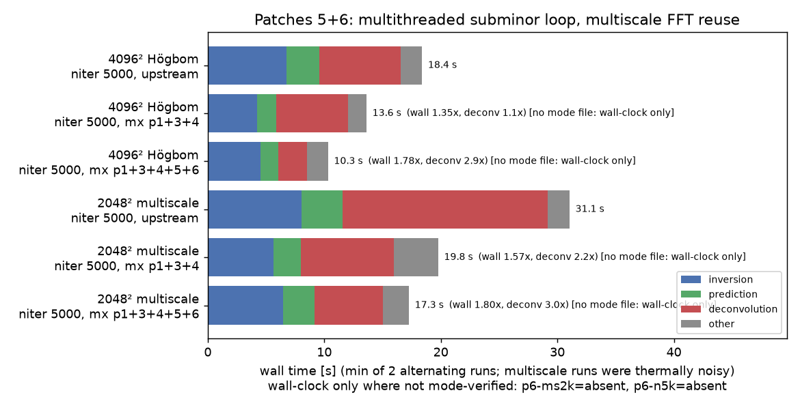

| Run | upstream-fix | mx-p3 | mx-p6 |
|-----|--------------|-------|-------|
| 4096² @ 0.03125° Högbom niter 5000, wall | 18.40 s | 13.63 s | **10.33 s** (1.78×) |
| same, deconvolution | 6.97 s | 6.20 s | **2.42 s** |
| 2048² multiscale niter 5000, deconvolution | 17.6 s | 7.97 s | **5.87 s** |

The multiscale row was measured on a hot, swapping machine and is noisy.
Patches 5 and 6 are bitwise identical to mx-p3 at `-j 1`.

### Deep cleaning, 4096²: patches 1+3+4

Commit [`c27e6ff`](https://github.com/peijin94/wsclean-mx/commit/c27e6ffac24c0c6eed2a32b507076d15106a59b7).
4096² @ 0.03125°, no threshold, min of 2, upstream-fix vs mx-p3.

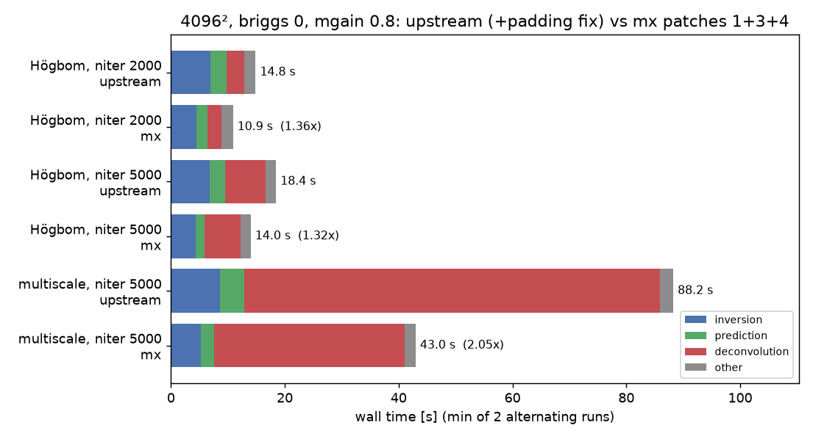

| Run | upstream-fix | mx-p3 | Inversion | Prediction | Deconvolution |
|-----|--------------|-------|-----------|------------|---------------|
| Högbom niter 2000 | 14.85 s | 10.88 s (1.36×) | 1.56× | 1.48× | 1.23× |
| Högbom niter 5000 | 18.44 s | 14.00 s (1.32×) | 1.56× | 1.74× | 1.13× |
| multiscale niter 5000 | 88.22 s | 42.95 s (2.05×) | 1.63× | 1.85× | 2.18× |

Multiscale clean is chaotic: a 1-ulp change in upstream's own convolution
moves model flux by 0.8%, more than the LINC vs upstream gap, so multiscale
images are judged against that spread.

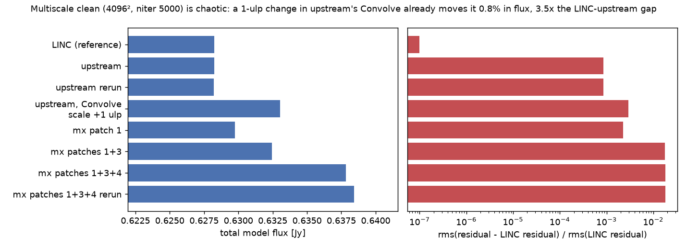

### Patch 1 and the baseline: 4096², niter 1000

Commit [`a55c6ff`](https://github.com/peijin94/wsclean-mx/commit/a55c6ffb39e408bf5d2fb87886ce91ad61441c45).
4096² @ 0.03125°, auto-threshold 3, min of 3.

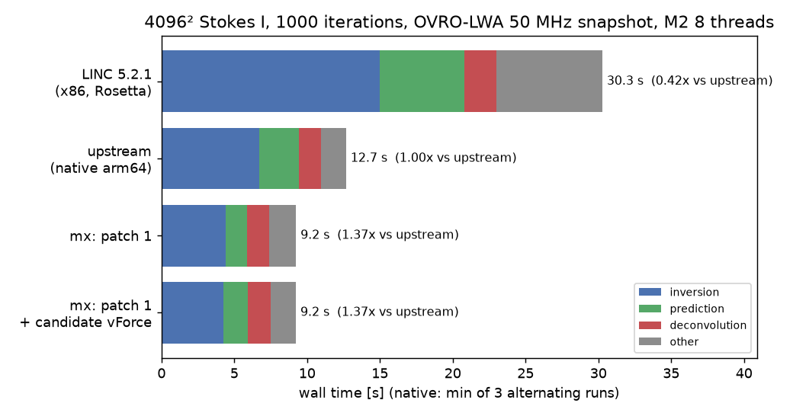

| Variant | Wall | Inversion | Prediction | Deconvolution |
|---------|------|-----------|------------|---------------|
| LINC, Apple container (Rosetta) | 30.3 s | 15.0 s | 5.8 s | 2.2 s |
| upstream, native | 12.69 s | 6.71 s | 2.75 s | — |
| wsclean-mx patch 1 | 9.25 s (1.37×) | 4.40 s | 1.49 s | — |

Upstream stops scaling at 4 threads (-j1 27.7 s, -j4 13.9 s, -j8 13.6 s)
because the main thread runs serial FFT work for 90% of the wall time:

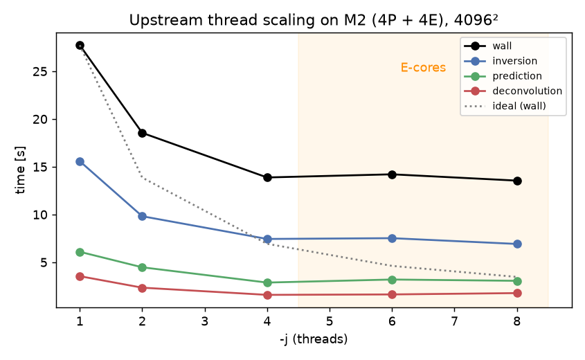
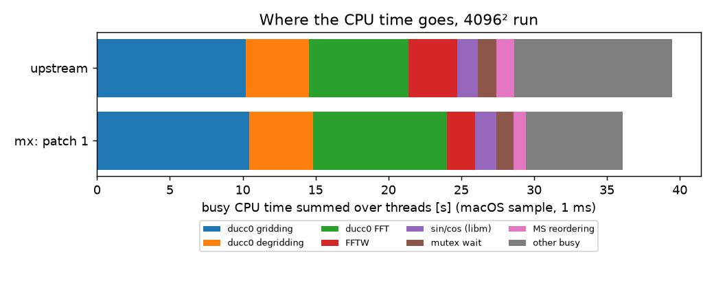

Accuracy of patch 1: dirty and PSF images match upstream to ~7e-7 rms;
cleaned products stay inside the upstream rerun spread.

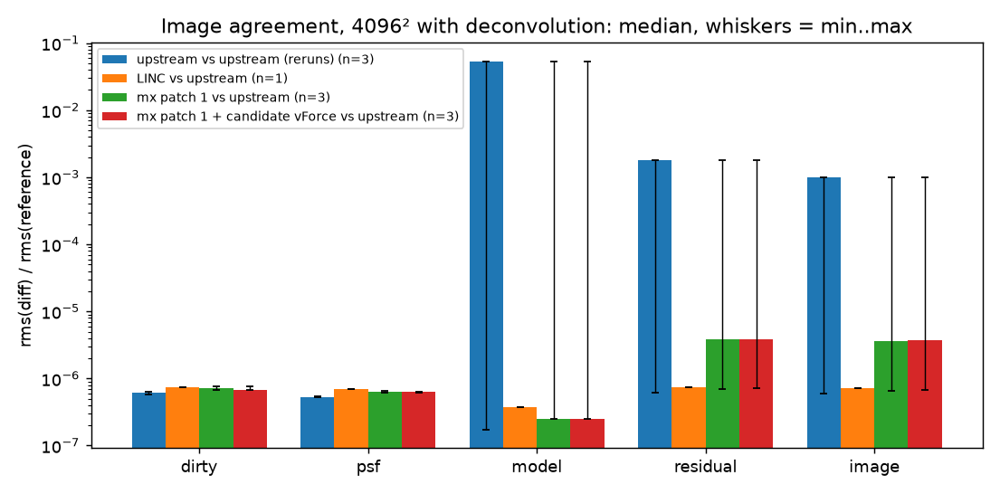

### Full-sky images: LINC vs upstream vs wsclean-mx

Commits [`1fe6bb3`](https://github.com/peijin94/wsclean-mx/commit/1fe6bb3),
[`eef12cd`](https://github.com/peijin94/wsclean-mx/commit/eef12cd).
1024² @ 0.125° (full sky).

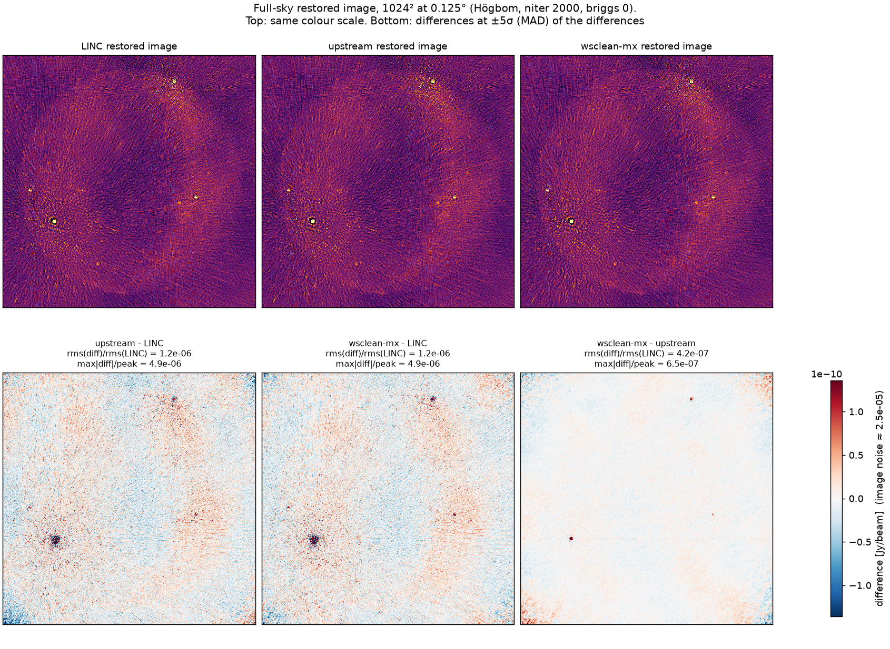

Högbom niter 2000: upstream and wsclean-mx match LINC to 1.2e-6 (restored
image), with the same 561 iterations.

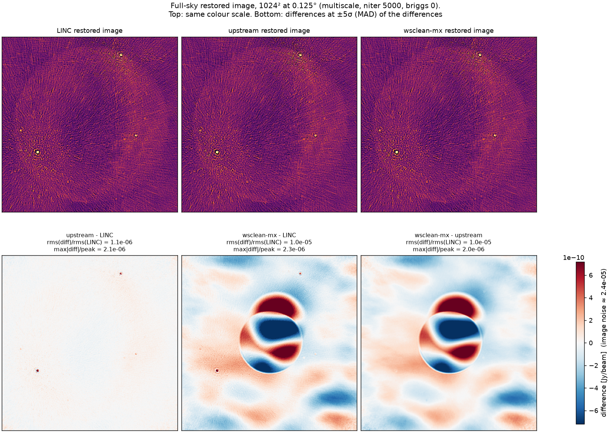
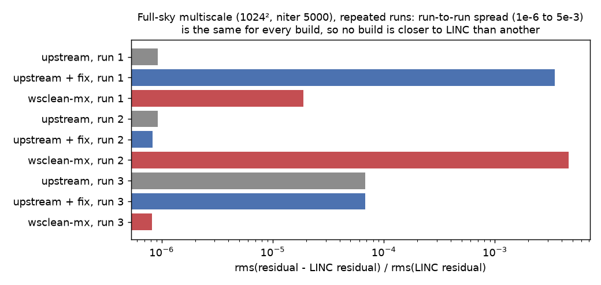

Multiscale niter 5000, 3 reruns each: the same binary lands at ~1e-6, ~5e-5
or ~4e-3 from LINC from run to run, for every build.

### Upstream bug: corrupt 2048² images on macOS

Commit [`c27e6ff`](https://github.com/peijin94/wsclean-mx/commit/c27e6ffac24c0c6eed2a32b507076d15106a59b7).

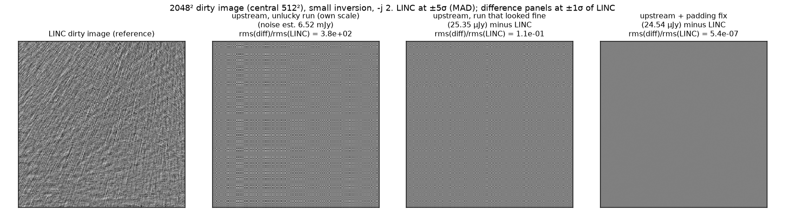

`WGridder::RealImage()` fills the image padding with NaN and relies on the
resampler to zero it, but the file is compiled with `-ffast-math` and Apple
clang drops the NaN fill. The padding is then uninitialized memory, and with
small inversion (the default) 4 of 6 2048² runs produced garbage dirty images.
GCC keeps the fill, so LINC is unaffected. Patch `wsclean/0001` pads with 0:
12/12 runs then match LINC to 5e-7.
