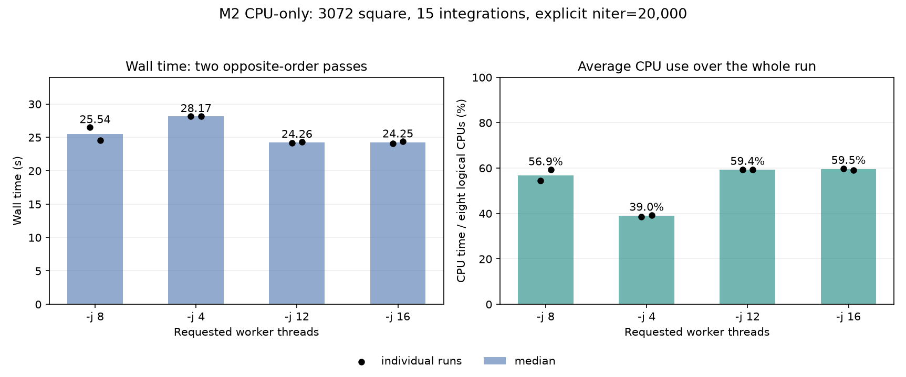

# Quick CPU thread sweep: 20k override - 2026-10-23

Same protected 15-integration MS, 3072 square / 2.7 arcmin, M2 (eight logical CPUs), CPU only.
One excluded j8 warmup, followed by j8/j4/j12/j16 and the reverse order. All eight measured runs used the same binary and unchanged imaging options except `-j`.
**20,000 iterations is an explicit override for this test. The 150,000 deep default is unchanged.**

| Requested threads | Wall samples (s) | Median wall (s) | Average occupied cores | Whole-machine CPU time (%) |
|---:|---|---:|---:|---:|
| 8 | 26.54, 24.54 | 25.54 | 4.55 | 56.9 |
| 4 | 28.14, 28.20 | 28.17 | 3.12 | 39.0 |
| 12 | 24.16, 24.35 | 24.26 | 4.75 | 59.4 |
| 16 | 24.10, 24.40 | 24.25 | 4.76 | 59.5 |

CPU columns are medians of the per-run `(user + system CPU seconds) / wall seconds`, with percent divided by the live logical CPU count (8). These are run averages, not instantaneous peaks; they include startup, I/O and all imaging phases. They do not weight performance and efficiency cores by frequency or IPC.

## Reading the result

- j12 and j16 are effectively tied. Their medians are about 5% below j8, but j8 spans 26.54 to 24.54 s: its faster repeat is close to both. Treat the 5% as a short-sweep observation, not an established improvement at full depth.
- j4 is consistently slower. Raising the request from 8 to 12/16 raises average occupied cores only from about 4.55 to 4.75/4.76; it does not saturate all eight hardware CPUs.
- More requested workers are therefore not by themselves a solution to the observed idle capacity. This sweep does not localize which waits, serial work or memory effects set the remaining limit.
- No imaging code, iteration default, or thread default was changed. No new issue update or push was requested.

## Stage times (medians, seconds)

| Threads | Inversion | Prediction | CLEAN | Other / I/O |
|---:|---:|---:|---:|---:|
| 8 | 14.583 | 3.615 | 5.048 | 2.295 |
| 4 | 16.806 | 4.138 | 5.074 | 2.151 |
| 12 | 13.992 | 3.315 | 4.856 | 2.092 |
| 16 | 13.963 | 3.331 | 4.706 | 2.251 |

## Work and numerical checks

- Every measured run completed exactly 20,000 iterations and one major cycle, stopping at the iteration cap. These are not converged 150k-budget timings.
- All four within-setting repeat comparisons pass T0 for all six products.
- All six cross-thread comparisons against j8 pass strict T2. j12 and j16 are also bitwise in every reported product; j4 is not bitwise, with maximum reported relative RMS 2.8e-6, below the unchanged gate.
- Protected input hashes/modes and the executable hash match before/after. All 108 MS files remain unchanged.
- System swap use stayed at `2598.38M` as reported by `sysctl vm.swapusage` through the measured batch. Load averages are retained per run. No build, sampling profiler, monitor, or heavy tests ran concurrently.
- This does not close older old/new scientific-equivalence failures or establish behavior for other geometries, iteration depths, machines or observing modes.

Raw launcher, logs, receipts, manifests and comparisons: `bench/out/threads20k-20261023-0717/`.
Re-render with `.venv/bin/python docs/bench/cpu-threads-20k-20261023/plot_results.py`.
The existing verified runner and timing parser were reused; no C++ rebuild was needed.
