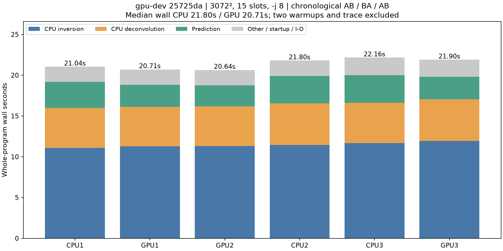
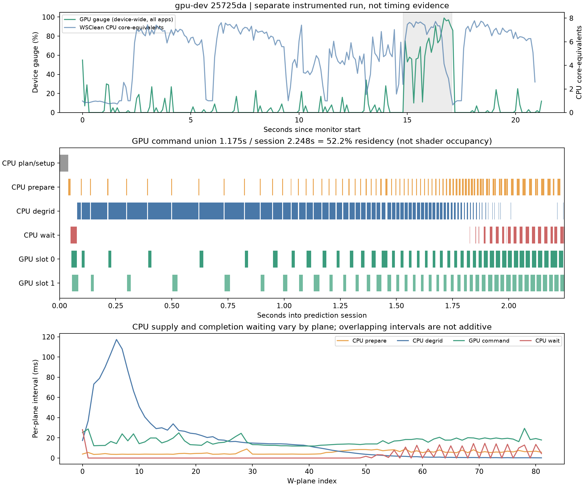
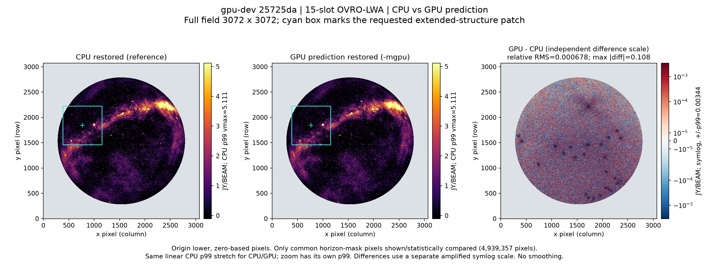
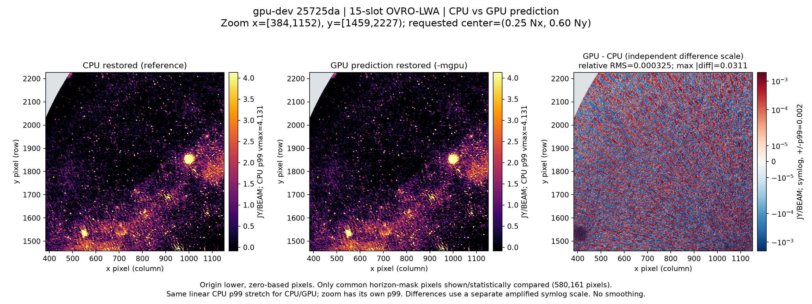

# Current GPU-dev benchmark and image-quality snapshot — 2026-10-22

**Benchmarked code version: [`25725da`](https://github.com/peijin94/wsclean-mx/commit/25725da84c01de0c97272f29604889a5ecae4613)** (`25725da84c01de0c97272f29604889a5ecae4613`). Developer WSClean commit: `c782c93c9402b8b198626320ce55f8565b671abf`; executable reports `mx-base-53-gc782c93c` (WSClean 3.7).

This is a **fresh measurement of the current executable**, not a new optimization. Both modes use the same `bench/bin/gpu-profile-delivered/wsclean` binary; SHA-256 `744bc73a6d1f7a68f33708e0cde598f7cfffbcb383be201a9d499969bb9f17c1`. GPU mode adds `-mgpu`: prediction FFTs use Metal; inversion, degridding and CLEAN remain on CPU/ducc0. Experimental GPU peak/convolution hooks are **off**. `main` and CPU release 0.1.0 are unchanged.

## Dataset and imaging dimensions

| Item | Measured value |
|---|---|
| Input | Standalone, read-only OVRO-LWA 15-slot Measurement Set |
| MS size | **4,428,203,949 bytes = 4.428 GB = 4.124 GiB**, across 108 files; logical file sizes, not allocated disk blocks |
| Time slots | **15**, each 10.031 s; 150.465 s summed integration |
| Observation timestamps | **2025-11-02 07:50:25.260–07:52:45.694 UTC** (integration-center timestamps) |
| Stored rows | **931,920**, or 62,128 per slot |
| Rows actually gridded/predicted | **926,640 cross-correlation rows** (61,776/slot); 5,280 autocorrelation rows excluded |
| Spectral/polarization dimensions | 48 channels, four stored correlations; imaging Stokes I; restored-image center **66.214600 MHz** |
| WSClean logged visibility count | **34,067,207** gridded row-channel samples per inversion, after its visibility filtering |
| Output | **3072 × 3072 pixels**, **2.7 arcmin/pixel**, elevation mask ≥10° |
| Actual prediction grid | **3960 × 3960 × 82 w-planes**; output pixel count is not FFT size |
| Machine | Apple M2, 8 CPU cores / 8 GPU cores, 16 GiB unified memory; `-j 8` |

[TaQL table-query receipts](dataset-table-queries.txt) verify the slot/row counts against the real table. The WSClean logs independently report `Gridding 926640 rows...` / `Predicting 926640 rows...`. All 108 input-file hashes in both the benchmark MS and original source remain unchanged after this campaign.

## Exact WSClean command used

The following is the actual command for the **first measured GPU run**, whose image is shown below (line wrapping only). The runner created the output/temp directories first and set **`MX_METAL_DEBUG_TIMING=1`** for completed-GPU-work proof; all other `MX_METAL_*` / `MX_WGRIDDER_*` settings were cleared. **No profiling or utilization monitor ran during timing measurements.**

```sh
/Users/peijinz/dev/wsclean-mx/bench/bin/gpu-profile-delivered/wsclean \
  -no-update-model-required \
  -temp-dir /Users/peijinz/dev/wsclean-mx/bench/out/gpu-status-20261022-142851-03-prediction/gpu-profile-delivered/tmp \
  -name /Users/peijinz/dev/wsclean-mx/bench/out/gpu-status-20261022-142851-03-prediction/gpu-profile-delivered/img \
  -mgpu \
  -j 8 \
  -size 3072 3072 \
  -scale 2.7amin \
  -weight briggs 0 \
  -pol I \
  -multiscale \
  -multiscale-scale-bias 0.8 \
  -niter 20000 \
  -mgain 0.95 \
  -auto-threshold 0.5 \
  -auto-mask 3 \
  -local-rms \
  -horizon-mask 10deg \
  -mem 40 \
  -reorder \
  /Users/peijinz/dev/wsclean-mx/bench/out/gpu-audit-20261022-0715/input-15.ms
```

The CPU runs use the same flags without `-mgpu`, and their own fresh output directories. The separate profiling run additionally sets `MX_METAL_PROFILE=1`, `MX_WGRIDDER_VERBOSE=1` and adds `-log-time`; it is excluded from timing statistics. Use **new output/temp paths** for a rerun rather than overwriting these products. Both displayed runs reached the **20,000-minor-iteration cap** and reported one major iteration; these are budget-limited images, not a claim of full CLEAN convergence.

## Benchmark results

Two excluded warmups, followed by **three CPU/GPU pairs in AB / BA / AB order**, then one separate profiled run. All nine executions finished successfully. Table values are medians of the three uninstrumented measurements per mode; independent stage medians are not summed into a synthetic wall time.

| Stage | CPU seconds | GPU-prediction seconds |
|---|---:|---:|
| Whole-program wall | 21.800 | 20.710 |
| Inversion (CPU) | 11.434 | 11.327 |
| Prediction | 3.369 | 2.702 |
| Deconvolution (CPU) | 4.957 | 4.869 |

Wall ranges: CPU **21.04–22.16 s**; GPU **20.64–21.90 s**. The matched-pair wall reductions are **1.57%, 5.32%, 1.17%** (median **1.57%**); the median paired prediction reduction is **18.64%**. This small cohort shows a modest, variable end-to-end gain—not a universal speedup estimate. The machine remained in normal desktop use, not an isolated benchmark environment. System swap before/after readings were unchanged at 2888.25 MiB for every run (not a measurement of zero swap I/O); no thermal warning was reported.



## Profiling: what limits this version

The separate trace completes **82 GPU planes**, with two shared buffers, **zero CPU fallback and zero grid-memcpy bytes**. GPU-command interval union is **1.175 s** in a **2.248 s** prediction session: **52.2% session residency**, or **5.56% of whole-run wall time**.

CPU degridding consumes **1.539 s**; preparation **0.444 s**; GPU-completion waiting **0.213 s**. These host spans overlap GPU execution; do not add them to GPU time. The measured bottleneck remains CPU supply, not continuous GPU arithmetic saturation.



The top GPU gauge is **device-wide** and includes other apps. Command residency is **not shader occupancy**; power, GPU frequency and hardware memory-bandwidth/occupancy counters were not measured.

## Restored image: full field

The image pair was fixed **before inspecting results**: the first measured CPU run (`gpu-status-20261022-142851-02-cpu`) and first measured GPU run (`gpu-status-20261022-142851-03-prediction`). It was **not selected for best agreement**.

Left: CPU reference. Middle: GPU prediction. Right: GPU minus CPU, deliberately amplified with its own symmetric-log scale. Both restored-image panels share the **CPU 99th-percentile** linear stretch; brighter pixels are clipped for display. No smoothing, registration or image renormalization was applied. Below-horizon pixels are masked gray. The cyan box marks the requested zoom.



Over the 4,939,357 common above-horizon pixels: restored-image relative RMS difference **0.00067787 (0.0678%)**; Pearson correlation **0.999999764**. The display clips at CPU p99 = **5.1115 Jy/beam**, not the **556.56 Jy/beam** peak.

## Extended-structure zoom at the requested location

Requested center `(0.25 × Nx, 0.60 × Ny)` maps to **(768, 1843.2)**, rounded to pixel **(768, 1843)**. Coordinates are **zero-based**, `x=column`, `y=row`, with **origin at the lower left**. The fixed **768 × 768** patch is **x=[384,1152), y=[1459,2227)**; it was not shifted to improve agreement.



The diffuse structure can be inspected side by side at the same stretch. Over 580,161 valid pixels in this patch: relative RMS difference **0.000325431 (0.0325%)**, Pearson correlation **0.999999947**. The zoom has its own shared CPU p99 = **4.1306 Jy/beam**; the difference panel has a separate amplified scale.

### Quality limits — visual agreement is not full scientific acceptance

**This is a visual/quantitative comparison, not an all-pass accuracy certificate.** The existing strict T2 comparator retains relative-RMS ≤1e-4 and relative-peak ≤1e-3, evaluated on the **full arrays**, not only the above-horizon visualization mask:

| Pair | Dirty / PSF / horizon mask | Restored / model / residual | Overall T2 |
|---|---|---|---|
| 1 — displayed images | Pass | Fail | **Fail** |
| 2 | Pass | Pass | **Pass** |
| 3 | Pass | Fail | **Fail** |

The displayed first pair's full-array restored relative RMS is **6.28e-4**, above the strict threshold. These failures are not waived or automatically attributed to CLEAN sensitivity. They are retained alongside the earlier full-pipeline source-family result of **6/10**. Matched-input/beam-preserving controls and small deterministic tests do not erase full-pipeline failures; calibrated absolute-photometry validation is not established by these plots.

Evidence: [full run/config/timing/profile/image metrics](results.json), [paired timing reductions](paired-timing.json), [pair 1 T2](pair1-T2.txt), [pair 2 T2](pair2-T2.txt), [pair 3 T2](pair3-T2.txt), [input integrity](input-integrity.json), [verification receipt](verification.json), [GPU command environment](gpu-command-environment.json), [exact GPU command](gpu-command.txt), [CPU command](cpu-command.txt), [GPU WSClean log](gpu-wsclean.log), [CPU WSClean log](cpu-wsclean.log). Raw FITS remain local; no original science input was modified. New commits carrying this report/renderer are publication artifacts; the **benchmarked imaging-code version remains `25725da`**.
