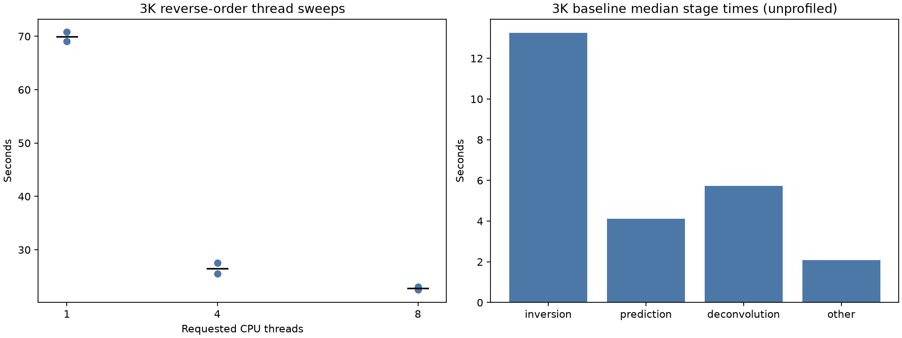
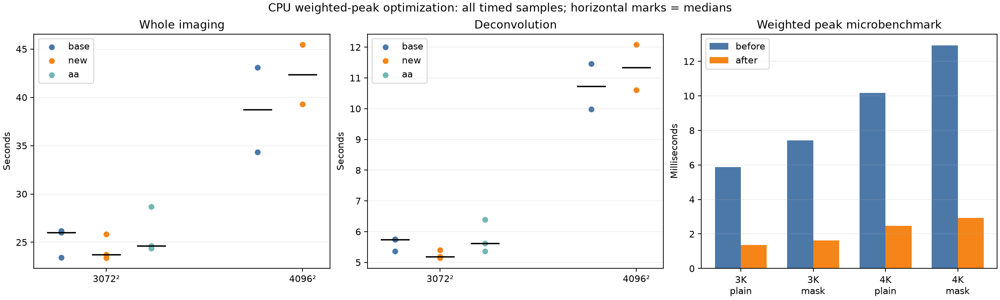

# CPU audit, profiling and weighted-peak optimization — 2026-10-22

## Result and limits

Implemented a narrow CPU optimization on `gpu-dev`: scan binary32 RMS-weighted
pixels directly instead of allocating and filling a weighted image before peak
selection. Radler developer commit **`1f1452e`**, exported as
`patches/mx/radler/0009-peak_finder-fuse-CPU-RMS-weighted-peak-scans.patch`.

- **4.1–4.5× faster weighted peak microbenchmarks**, including masked searches.
- Removes one touched full-image temporary per applicable scale search:
  **36 MiB at 3072²; 64 MiB at 4096²**. The surrounding public search still
  allocates its transformed image; the whole algorithm is not allocation-free.
- All six FITS data arrays match the pre-change CPU baseline **bitwise at one
  thread**, both for the frozen candidate and the rebuilt `build-mx/wsclean`.
- **No reliable end-to-end speedup or RSS reduction is established.** Host load,
  memory pressure and identical-binary controls are too variable for that claim.
- Strict threaded image gates retain failures, including identical-baseline
  controls. A separate native Radler test also fails on pre-change source.
  This is a development optimization, **not a fully green scientific release**.

No changes to inversion, prediction, MS readers, GPU kernels, or numerical gate
thresholds are included. `main` and the published CPU release are unchanged.

## Scope, provenance and input protection

The predeclared plan is [cpu-optimization-plan-2026-10-22.md](cpu-optimization-plan-2026-10-22.md).
Starting root revision: `757e36a`; WSClean `ff01a434`, Radler `ea55b61`,
Schaapcommon `d6e5eee`, Aocommon `dd2b059`. This comparison isolates the new
weighted scan from the already optimized development stack; it is not a new
comparison against pristine upstream.

Host: Apple M2, eight cores, 16 GiB; Apple clang 21, Release `-O3 -DNDEBUG`.
The production build has `WSCLEAN_MX_METAL=OFF`; no `-mgpu` is used. The frozen
variants are `cpu-audit-base-20261022`, its byte-identical executable/library
copy `cpu-audit-aa-20261022`, and `cpu-weighted-v1-20261022`. Snapshot copies
freeze the executable and Schaapcommon threading library, not every external
dynamic dependency. Binary hashes, source-diff hashes and linkage are retained
in the results' provenance object.

The real 15-integration MS is
`bench/out/gpu-audit-20261022-0715/input-15.ms`. All **108 files / 4,428,203,949
bytes** remain read-only, with identical before/after content hashes and modes.
No original-MS prediction, deletion of prior output, source reset, or pristine
`upstream/wsclean` edit occurred.

Source reading covered main/driver, selection/reordering/readers and limit
calculation, ducc0 imaging wrappers and FFT/convolution, Radler scale transforms,
peak/RMS handling, restoration and the separate in-memory loader. This is not an
exhaustive audit of every external dependency or observing mode.

## What the profiles show

### Thread scaling

Two opposite-order sweeps, one warmup, 3072² at 2.7 arcmin/pixel:

| Requested threads | Wall samples (s) | Median (s) |
|---:|---|---:|
| 1 | 70.79, 69.09 | 69.94 |
| 4 | 27.53, 25.48 | 26.505 |
| 8 | 23.05, 22.53 | 22.79 |

Eight threads were fastest among the tested settings, **3.07×** the one-thread
median. These runs consumed 4.76–4.90 CPU-seconds per wall-second at `-j 8`, not
eight continuously busy cores. This does not establish an optimum above eight
threads or equal throughput for the M2's heterogeneous cores.



The later three-run 3K baseline medians were inversion **13.257 s**, prediction
**4.110 s**, deconvolution **5.739 s**, and other **2.096 s**. These are independent
stage medians, not a synthetic run assembled by summing best stages.

### Separate sampled profiles

The sampled 3K and 4K runs took 30.69 and 34.26 s. Instrumentation is excluded
from ordinary timing comparisons. Both used an internal dirty grid of 2616² and
a ducc0 grid of 3960², with 82 and 81 w-planes respectively. The larger requested
image mainly increases the later image/deconvolution work in this configuration;
it does not simply enlarge every inversion FFT.

Ducc0's own sampled-run phase tables put gridding proper around **45%** of its
inversion work, FFTs around **32–33%**, and w-screen/grid corrections around
**13–14%**. The 3K prediction table reports **40.76% degridding**, **37.35% FFT**
and **12.06% w-screen/correction**. These percentages describe this workload,
not earlier experiments with different layouts.

Self-time samples identify the SIMD grid/degrid helpers, FFT input/output
packing, FFT butterflies and convolution multiply/inverse work. Peak selection
is a smaller target, not the dominant whole-run bottleneck. Pool waits account
for 61.6%/63.2% of aggregate thread samples: **that is not process CPU-idle
percentage**. Idle workers and inclusive parent stacks must not be mistaken for
independent compute costs. Separate Schaapcommon and ducc0 pools need joint
measurement before changing concurrency.

## Implemented change

`work/radler/cpp/math/peak_finder.cc` adds a weighted scan with independent
lane maxima and an ordered rescan only when a row raises the peak. The product
is rounded to `float` before comparison. It preserves signed output, first
row-major ties, masks, row/border bounds, NaNs/infinities, the minimum-normal
threshold and no-peak coordinates. Images, weights and masks remain immutable.

`ThreadedDeconvolutionTools::FindSingleScalePeak` uses it only on the non-AVX CPU
path without a registered peak hook. The registered GPU adapter and x86 AVX
branches retain their previous scratch and selection behavior. Sequential RMS
arithmetic is unchanged. `MultiScaleAlgorithm::FindPeakDirect` and its existing
scratch are **not** changed by this patch.

The public allocation test was RED before implementation: all four unhooked
weighted cases allocated two full images instead of the target one. The revised
16-scenario test covers weighted/unweighted, masked/unmasked, RMS on/off and a
registered-but-refusing hook. The latter deliberately retains the old scratch.

### Linked microbenchmarks

One excluded warmup and eight measured samples per shape/mask/implementation,
with alternating order. Times are medians of the real linked implementation;
the reference materializes products then calls the existing peak oracle.

| Shape | Mask | Before (ms) | After (ms) | Speedup |
|---|---|---:|---:|---:|
| 3072² | No | 5.885 | 1.365 | 4.31× |
| 3072² | Yes | 7.413 | 1.637 | 4.53× |
| 4096² | No | 10.176 | 2.459 | 4.14× |
| 4096² | Yes | 12.936 | 2.922 | 4.43× |

### End-to-end measurements: do not extrapolate the kernel ratio

Deep runs use 20,000 maximum iterations, multiscale bias 0.8, mgain 0.95,
local RMS, auto-mask 3, auto-threshold 0.5, Briggs 0, horizon mask 10 degrees,
reordering and memory fraction 40%. Geometry is 3072²/2.7 arcmin or
4096²/2 arcmin. Compilation and heavy tests were not run alongside timed batches.

| Batch | Variant | Repeats | Wall median (s) | Deconvolution median (s) |
|---|---|---:|---:|---:|
| Initial 3K | Baseline | 3 | 26.01 | 5.739 |
| Initial 3K | Candidate | 3 | 23.73 | 5.181 |
| Initial 3K | Identical baseline copy | 3 | 24.64 | 5.622 |
| Initial 4K | Baseline | 2 | 38.715 | 10.726 |
| Initial 4K | Candidate | 2 | 42.370 | 11.346 |
| Separate 4K confirmation | Baseline | 2 | 27.15 | 8.705 |
| Separate 4K confirmation | Candidate | 2 | 26.75 | 8.183 |
| Separate 4K confirmation | Identical baseline copy | 2 | 26.90 | 7.941 |

The initial 3K pooled wall medians suggest 8.8%, but the median **within-repeat
wall reduction is only 0.62%**; the paired deconvolution reduction is 5.88%.
Those are descriptive measurements, not a reliable whole-run causal estimate.

The initial 4K slowdown coincided with one-minute host load rising to 33.8.
The separate, reversed-order baseline/candidate/A-A confirmation did not reproduce
that slowdown. Its unchanged baseline copy also beats the candidate in
median deconvolution time. Instructions were slightly lower for the candidate,
while wall times changed far more across host episodes. Peak RSS varied enough
that even the sign of a memory-saving claim is not stable. **Keep the resource
simplification; do not promise end-to-end speed or measured RSS savings.**



The figure preserves the original slow 4K batch. Confirmation data are separate
in `bench/cpu-opt-20261022/confirmation.json`, not pooled to conceal it.

## Numerical and native verification

| Check | Outcome |
|---|---|
| Weighted differential suite | 10,084 checks, zero failures; includes rounded-product ties across lanes, exact normal floor, masks, borders, signs, nonfinites and input preservation |
| Public allocation/hook regression | 16 scenarios, zero failures; original RED evidence retained |
| Deterministic 3K candidate vs old CPU | All six FITS data arrays T0/bitwise |
| Actual `build-mx/wsclean` vs old CPU, 3K/one thread | All six FITS data arrays T0/bitwise |
| Matched dirty/PSF, eight threads | Models, dirty, PSF and horizon mask bitwise; restored/residual images fail strict T0 for candidate **and** A/A |
| Full threaded 3K, strict T2 | Candidate 2/3 pass; identical-baseline copy 1/3 pass |
| Initial full threaded 4K, strict T2 | Candidate 2/2 pass |
| 4K confirmation, strict T2 | Candidate 1/2 and A/A 1/2 pass |
| Native WSClean | 160 passed, four skipped; 869,917 assertions passed |
| Native Radler after fixture setup | 124/125 cases pass; one inherited test remains failing |

The matched-input model is bitwise identical, but a later threaded inversion
still changes residual/restored pixels: freezing the initial dirty and PSF does
not freeze the entire imaging pipeline. Candidate restored/residual relative RMS
is 1.71e-6/2.25e-6; A/A is 1.57e-6/2.07e-6. Both pass T2, **neither passes the
originally requested whole-product T0**. The failed T0 verdicts stay in the data.

The strict T2 limits remain relative RMS 1e-4 and relative peak difference 1e-3.
The first 3K candidate model failure has relative RMS 0.001550473; its same-round
A/A control is 0.001550470. Another A/A model reaches 0.006125661. These controls
show that the checks are sensitive to baseline variation; they do not automatically
waive failures or certify all downstream science. The analyzer intentionally
returns **exit 1** for the retained strict failures.

The four WSClean skips are two baseline-dependent-averaging cases and two
average-correction cases. Radler initially also lacked its Vela FITS fixture;
the configured `download_test_data` target fetched and hash-verified it, after
which `radler_main` passed. The persistent case is
`dijkstra_splitter/get_bounding_mask`: **14 failed assertions in one test case**.
Extracting its exact pre-change `ea55b61` source and test into an isolated
reproducer produces the same 14 failures (exit 201), without linking the new
weighted scan. This is a documented baseline failure, not a new scan regression.

The linked project suite, analyzer adversarial tests, independent review and
final receipts are summarized in `bench/cpu-opt-20261022/delivery.json`. Review
caught three analyzer weaknesses (missing expected products on both sides,
duplicated/mislabeled micro samples, and validation disabled by Python `-O`).
They were repaired with RED/GREEN tests; original numerical failures and
thresholds were not changed. No active Metal hardware suite was rerun for this
CPU-only change; hook-refusal routing is exercised by the linked CPU test.

## Findings and ordered follow-up work

These are separate from the delivered weighted-scan patch. Source findings are
not claimed as completed end-to-end reproductions.

| Priority | Finding and source evidence | Required next verification |
|---|---|---|
| P1 | Reordered payload positions: `reorderedmsreader.cpp:60,118` advances metadata but reads weights sequentially; `msprovidercollection.cpp:196` conditionally reads weights while advancing every row | Synthetic rows with distinct data/weights, skipped/repeated/interleaved reads and variable channel counts. Track stream positions without adding a seek to every sequential read |
| P1 | UV limits: `msprovidercollection.cpp:25` calculates vertical coordinate with `u`, not `v`; weight lookup can conceal the effect | Independent rectangular/anisotropic footprint oracle and Nyquist boundary cases; verify extrema/grid-planning changes |
| P1 | `rms_image.cc:35–65` sliding minimum rescans windows and can dereference an empty range for a zero radius; oversized unsigned bounds also need checking | Preserve half-open window semantics; test tiny/oversized windows, one-pixel dimensions, NaNs and aliasing before optimizing |
| P1 | Native Dijkstra bounding-mask failure reproduced on pre-change source | Attribute the implementation/test discrepancy before changing parallel-subimage masks; do not disable the test |
| P2 | `convolution.cc:172–175` allocates a complex product per inverse convolution, with separate shared thread pools | Caller-owned bounded workspace, immutable-spectrum checks, concurrent correctness and allocation/RSS measurements; no unbounded per-thread cache |
| P2 | `multiscale_algorithm.cc:662–663` copies per-scale masks; `FindPeakDirect` still materializes weighted scratch | Borrow immutable masks only across the synchronous lifetime, test mask updates/first ties, and independently benchmark the direct-peak caller |
| P2 | Dominant ducc0 grid/degrid and FFT packing remain unchanged | Profile/ablate layout and scheduling changes on this exact grid before rewriting arithmetic or assuming additional threads help |

The disk in-memory loader's ANTENNA2/WEIGHT_SPECTRUM issues are dormant in the
normal executable: `main/commandline.cpp:1524` overwrites the CLI flag with the
executable's false argument, while caller-provided API data bypasses that loader.
They must be fixed before enabling it, but are not evidence of current normal-CLI
failure. The older development-plan description was corrected accordingly.

## Reproduction and artifacts

From the repository root:

```sh
JOBS=4 bash scripts/test.sh build-mx
(cd build-test && ./unittest --report_level=detailed)
/opt/homebrew/bin/ctest --test-dir build-test/_deps/radler-build -R '^unittests_' --output-on-failure
.venv/bin/python -O -m unittest discover -s tests -p test_cpu_campaign_analyzer.py -v
.venv/bin/python bench/analyze_cpu_campaign.py
```

The CTest command currently retains the inherited Dijkstra failure. The analyzer
returns 1 for retained strict image failures; neither exit should be hidden.

- Compact evidence, figures, plans and delivery receipts: `docs/bench/cpu-opt-20261022/`.
- Original logs, run launchers, RED/GREEN evidence, sampled stacks, input manifests,
  live-executable products and reviews: `bench/out/cpu-opt-20261022-2035/`.
- Individual science outputs: `bench/out/cpuaudit-20261022-*`,
  `bench/out/cpuopt-20261022-*`, and `bench/out/cpuconfirm-20261022-*`.
- `bench/analyze_cpu_campaign.py` verifies run identities, exact product inventory
  and micro tuples and reproduces the initial summary and both figures.
- Patch replay uses isolated Git indexes. All four exported component trees match
  their developer HEADs: WSClean 54 patches, Radler 9, Schaapcommon 8, Aocommon 2.
  Old whitespace warnings in WSClean patch 0036 are retained, not new failures.

No push, release, merge into `main`, or issue-state transition is part of this pass.
