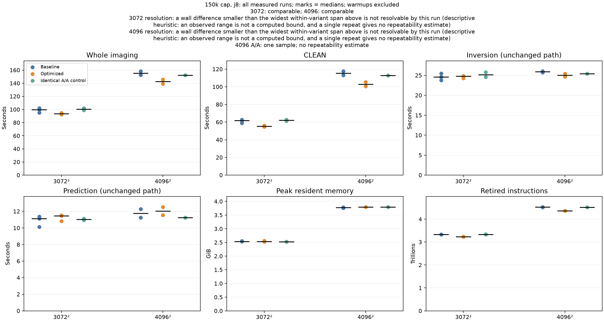
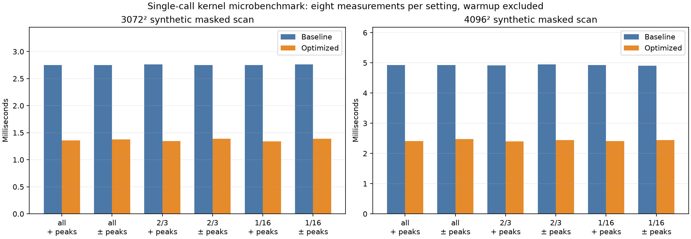
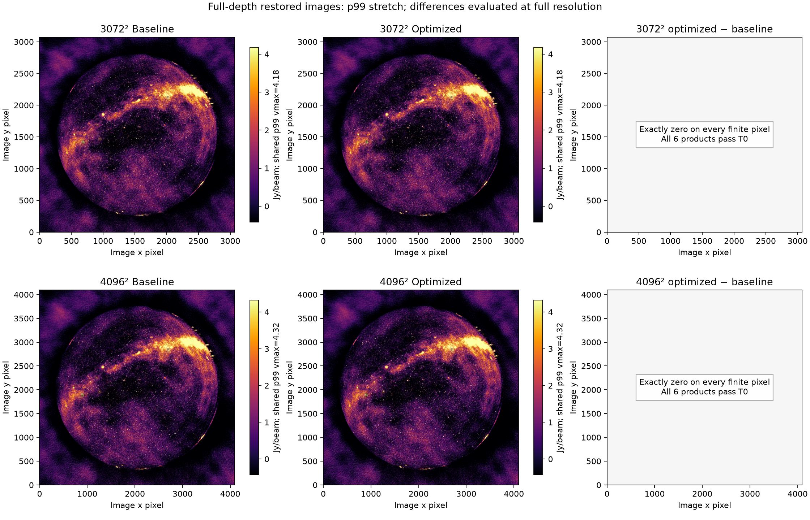

# CPU copy removal and masked-peak optimization — 2026-10-23

## Status

**The optimization, report checks and full-depth image verification pass: 19 runs and 114 bitwise product comparisons, including the rebuilt default executable.** CLEAN median time falls about 10.8% at both sizes. Changes and evidence are delivered locally; nothing has been published remotely.

This pass compares against the **current repaired CPU baseline**, not pristine upstream or the older legacy baseline. The legacy-reference failures in [the correctness report](cpu-correctness-repairs-2026-10-22.md) remain separate and are not waived by these results. Metal inversion stays retired; no GPU activation, thread default, iteration default or science threshold is changed.

## Inspected scope and selection

The read-only source audit covered Radler multiscale/subminor/peak callers, Schaapcommon convolution and ownership boundaries, ducc0 ordered gridding and scheduler lifetimes, and WSClean prediction buffers. Git blame was used to distinguish deliberate ordering/cache guards from accidental copies.

Fresh, separately sampled **150k-cap, j8** 3072² and 4096² runs reproduced the earlier current-build outputs bitwise. Main-thread self samples attributed approximately **7.94% / 9.34% to memmove** and **6.45% / 6.58% to the scalar masked peak finder**. These are main-thread sample fractions, not independent whole-run costs or projected speedups. Thread records were combined by numeric identity across main-thread renames. Sampled runs are excluded from timing claims.

The selected changes remove work from those paths without changing FFT arithmetic, reductions, peak ties or masks. Unmeasured gridding/helper-pool rewrites were not implemented just because the CPU utilization was below 100%.

## Changes

| Area | Implementation | Preserved contract |
|---|---|---|
| Scalar transform | Replace `vector(1, std::move(image))`, which still copies via the fill constructor, with a synchronous borrowed-image range shared by scalar and vector entry points | Same FFT/kernel/inverse sequence; image dimensions, storage and padded tail retained |
| Model update | Replace the initializer-list image adapter, whose const elements force a copy, with the scalar transform call | Same logical transform dimensions and model arithmetic |
| Masked peak scan | Reuse the vectorizable row reduction with compile-time weighting disabled; recover the first eligible row-major maximum and stop once that known maximum is found | Normal-float floor, signs, masks, NaN/infinity behavior, first ties and optional sentinels; weighted recovery and unmasked float/double/AVX paths unchanged |
| Masked border safety | Return an empty region before unsigned subtraction wraps for oversized borders | Normal valid-region behavior unchanged; no-peak coordinates remain `(width,height)` |
| PSF setup | Share the identical nonzero-scale transform branch; remove the second unchanged zero-scale PSF copy | Scale order, center sample, gain/bias metadata and logging retained |
| Optional component fitting | Default-construct the ignored transform scratch argument | No public API change or scratch reads introduced |

The two image adapters now retain valid owning `Image` objects if convolution throws. This is an explicitly documented **in-place** contract: pixel rollback is not promised. The deliberate immutable-kernel publication copy remains untouched. No new persistent cache, global workspace or asynchronous borrowed lifetime was added.

## RED/GREEN and independent checks

- The warmed scalar-transform resource test failed on the original implementation with **one extra full-image allocation**, then passed with **zero**. This is an allocation/copy claim, not an assumed equal RSS saving.
- The original masked oversized-border test produced an **ASan heap-buffer-overflow, exit 134**. Its log is retained; the fixed path passes.
- Masked/weighted tests use an **independent sequential oracle**, not the newly shared implementation as its own reference. Native and ASan/UBSan runs pass **213,321 checks**, including signed ties, sparse/all-false masks, borders, zero/subnormal/normal-floor values, infinities/NaNs, first-column maxima and the inherited lowest-float `OptionalNumber` sentinel collision.
- Transform tests pass **720 scenarios / 15,332 checks**: both kernel shapes, odd/even rectangular sizes, one/four threads, multiple images, oversized storage and untouched tails, warmed kernels, absent/refusing/successful inverse hooks and exceptions. Numerical output is checked bitwise against the original prepare/finish transform route. Parent native and sanitizer replays pass; sanitizer-linked dependencies are not all instrumented.
- `scripts/test.sh build-mx` passes the linked production numerical/provider/resource/scheduler regressions. After the report-parser follow-up, the final full Python suite passes **246 tests**; the **17 report tests** also pass with `python -O` and in an isolated source copy with no `bench/out` artifacts.
- Native WSClean: **160 passed, four existing skips**, **869,917 assertions**. Native Radler: **all four executable suites pass**, along with four prerequisite build entries (8/8 CTest entries). Empty Schaapcommon CTest enumeration is not counted as a suite pass. Active Metal hardware gates were not rerun.
- An independent correctness review approves the final source and validation driver with no blocking logic/security findings. Four separate cleanup reviews cover reuse, quality, efficiency and abstraction depth. They are static reviews, not substitutes for parent execution. The initial unsupported-model delegation failure is retained and superseded by working local Codex reviews.

The final synthetic masked-scan microbenchmark is **1.98–2.06× faster** across the tested 3K/4K, positive/signed-peak and dense/sparse-mask settings, using eight measured samples per setting after an excluded warmup. This is **not** a whole-WSClean speedup claim.

The report code also received RED/GREEN repairs. The initial review rejected weak run/gate/product binding and infinity handling. A clean-source-copy test exposed an ignored-artifact import; the summarizer is now tracked. Actual campaign logs then exposed an over-strict parser: per-major-cycle threshold messages can repeat, while global completion records must remain unique and ordered. The corrected parser passes all real logs and targeted adversarial tests. Rejected reviews, failing attempts and sandbox-blocked worker checks remain recorded; only successful parent executions count as validation. All three figures were generated and inspected.

## Full-depth configuration and acceptance

- CPU-only, eight threads; 3072² at 2.7 arcmin/pixel or 4096² at 2 arcmin/pixel.
- Multiscale bias 0.8, **150,000 iteration cap**, gain 0.95, auto-threshold 0.5, auto-mask 3, local RMS, 10-degree horizon mask, Briggs 0, 40% memory, reorder and no model writeback.
- The original OS-read-only 15-integration MS is hashed, including file modes, before and after the campaign. No original-data writes are permitted.
- Frozen variants: `cpu-next-base-20261023`, its byte-identical `cpu-next-aa-20261023` control, and `cpu-next-candidate-20261023`. The executable and threading library are frozen; other loaded non-system dependencies are hash-verified before/after but remain installed external files.
- Predeclared **17 sequential runs**: four correctness/warmup runs, three paired 3K repetitions, two paired 4K repetitions, and three A/A controls. Counterbalanced baseline/candidate order; no sampling, compilation or heavy test suites during timing. All warmups and every raw sample are retained.
- Every run must reproduce the baseline's final-threshold termination, three major cycles and completed work: **93,854 components at 3K; 97,873 at 4K**. These are converged runs under a 150k cap, not runs forced to execute 150k components.
- Required products: dirty, horizon mask, restored image, model, PSF and residual. **T0 means bitwise data-array and dtype identity**, not FITS-file identity: timestamps and provenance headers differ. No tolerance is loosened.
- Timings, stages, peak RSS, retired instructions/cycles, load, swap and thermal receipts are recorded per run. The tracked A/B classifier and byte-identical control distinguish host timing modes from a claimed code cost.

## Measured results

The table uses only the 13 uninstrumented measured trials; four warmups and the two final-default confirmations are excluded. Values are **metricwise medians**, not a synthetic run assembled from best stage times.

| Size | Baseline / optimized samples | Wall median, before → after | Observed wall reduction | CLEAN median, before → after | CLEAN reduction |
|---|---|---|---|---|---|
| 3072² | 3 / 3 | 99.71 → 93.63 s | 6.1% | 61.87 → 55.18 s | 10.8% |
| 4096² | 2 / 2 | 155.31 → 142.43 s | 8.3% | 115.25 → 102.86 s | 10.8% |

All timing samples, in execution order within each role:

| Size | Baseline wall (s) | Optimized wall (s) | Byte-identical A/A control wall (s) |
|---|---|---|---|
| 3072² | 95.22, 99.71, 102.07 | 92.17, 93.63, 94.75 | 98.91, 101.94 |
| 4096² | 158.23, 152.39 | 145.60, 139.25 | 151.96 |

Both existing hardware-counter classifications are **comparable**, not a detected stall-mode mismatch. Retired instructions fall 2.9% / 3.6%, and cycles fall 3.1% / 3.6%. Paired wall reductions span 3.2–7.2% at 3K and 8.0–8.6% at 4K; paired CLEAN reductions span 7.4–10.8% and 10.5–11.0%.

**Do not overstate precision:** the 3K median wall reduction (6.1%) is smaller than the widest baseline wall span (6.7%). The classifier's conservative range heuristic therefore does not resolve that whole-run percentage precisely, despite all three pairs improving and reduced CLEAN/instruction costs. The 4K wall reduction exceeds its widest within-role span (4.4%), but there are only two pairs and **one A/A sample**, so this is workload-specific evidence, not a universal performance bound.

Unchanged-stage medians are retained as controls: inversion 24.62 → 24.78 s and prediction 11.12 → 11.44 s at 3K; inversion 25.89 → 25.03 s and prediction 11.76 → 12.04 s at 4K. No acceleration of those unchanged paths is attributed to this patch.

**No RSS reduction is established.** Median peak RSS is 2598.7 → 2596.8 MiB at 3K and 3863.7 → 3884.3 MiB at 4K. Removing full-image allocations/copies does not imply that another phase's maximum resident footprint falls.





### Numerical consistency and final default

All **17 campaign comparisons / 102 product arrays** are bitwise equal to the frozen current baseline. The parent independently rechecked label/path/tier/product binding, dimensions, zero differences, last printed iteration, component totals, per-scale sums and candidate hashes. After the Radler commit/export and a fresh configure/build, the actual `build-mx/wsclean` completed two more 150k-cap 3K/4K runs: **both six-product T0 checks pass**. Thus 19 full-depth runs and 114 product comparisons pass, with no changed input contents or file modes.



These checks establish consistency with this repaired baseline, at these sizes/settings. They do not retroactively resolve the older legacy-reference failures, validate every observing mode, or establish active Metal acceptance.

## Deferred work

| Candidate | Why it is separate | Required acceptance |
|---|---|---|
| Fuse RMS multiplication in `FindPeakDirect` | Needs caller-level mask precedence, normalization and AVX compatibility coverage | Independent caller oracle, exact output/position/state checks, full-depth T0 and measured benefit |
| Reuse one PSF forward FFT across scales | Existing API can do it, but setup cost was not isolated in this pass | Both shapes, zero-only/mixed scales, distinct PSFs and bitwise pixels/ScaleInfo |
| Consuming transformed-convolution API | Changes a dependency ownership boundary; const-spectrum preservation is deliberate | Mutable/const differential tests, kernels immutable, hook/fallback/exception checks |
| Borrow per-scale masks | Removes copies but introduces lifetimes across worker/hook calls | Conflicting global/per-scale masks, weighted/tie cases, draining and allocation tests |
| Reuse subminor buffers or bounded gridding helper slots | Cost still unmeasured; stale state or altered block grouping can break determinism | Allocation/work ablation, periodic/BDA/mixed-precision tests, ordered merge and exception lifetime gates |

Do not infer that these proposals are bottlenecks or measured speedups. No broad public-API rewrite, cache expansion, reduction-order change or GPU-inversion restart is included.

## Reproduction and evidence

```sh
JOBS=4 bash scripts/test.sh build-mx
(cd build-test && ./unittest --report_level=detailed)
/opt/homebrew/bin/ctest --test-dir build-test/_deps/radler-build --output-on-failure
.venv/bin/python docs/bench/cpu-copy-peak-20261023/plot_results.py
```

The tracked `summarize.py` records the one-shot aggregation procedure; it requires retained raw data and deliberately refuses existing summary/mode outputs. Figure rendering uses the committed compact results and hash-checked local FITS files. See the [evidence README](bench/cpu-copy-peak-20261023/README.md).

Raw plans, commands, failed/passing tests, source reviews, sampled profiles, frozen-build receipts and per-run measurements: `bench/out/cpu-next-20261023-1106/`. Protected FITS products use fresh `bench/out/cpu-next-v1-20261023-*` paths. Compact results and figure scripts: `docs/bench/cpu-copy-peak-20261023/`.

## Delivery state

Radler developer commit: `bc85f147e30990e3831e85121076843bb8837e63`.
Additive export: `patches/mx/radler/0011-verified-Remove-multiscale-image-copies-and-vectoriz.patch`.
All four source trees match isolated-index replay: WSClean 55 patches, Radler 11, Schaapcommon 9 and Aocommon 2 (**77 total**). The actual final default executable SHA-256 is `f5e07843c929206a5c3e27ba2fba177396d907923c75967ccd9d8690673f9760`; measured snapshot and source fingerprints are recorded separately.

Report-tool validation and figures are complete. The root patch set, regression tests, compact evidence, plotting/validation scripts and project notes are committed locally. Nothing from this pass has been pushed, published to an issue, released or merged into `main`.
