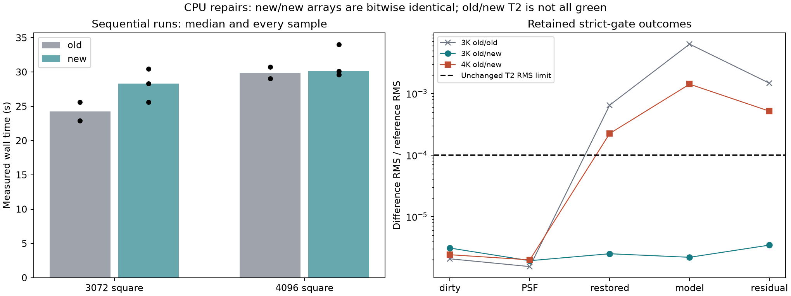
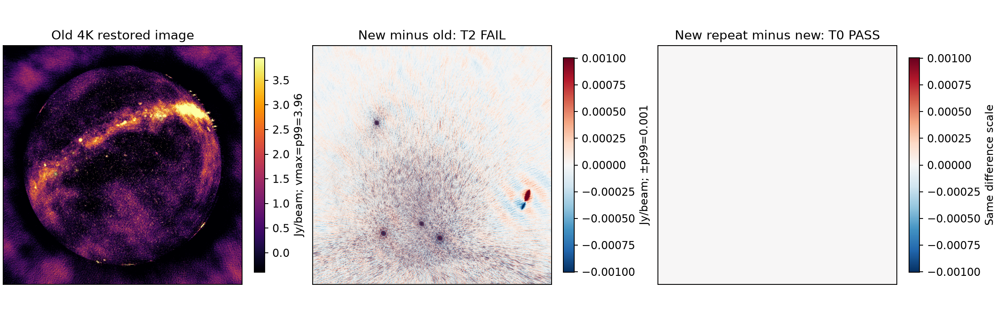

# CPU correctness repairs — 2026-10-22

## Result

**The source repairs are implemented, independently reviewed, and locally exported. Strict legacy-image acceptance is not fully green.** The final default CPU executable produces bitwise-repeatable eight-thread 3K/4K images, but old/new 4K T2 and an additional one-thread old/new T0 check fail. No threshold was relaxed, failure erased, dormant CLI path enabled, release published, or merge into `main` performed.

This follows the [repair plan](cpu-correctness-plan-2026-10-22.md) and [CPU audit](cpu-audit-2026-10-22.md). The earlier weighted-peak optimization's measurements remain separate.

## Implemented repairs

| Area | Change | Executed verification |
|---|---|---|
| Dijkstra masks | Prevent origin-padding underflow; return empty bounds for empty intersections/strips. Keep the shortest-path tie policy unchanged. The exact mask fixture supplies explicit divider geometry; separate path tests verify cost/validity without assuming an unspecified equal-cost queue order. | ASan/UBSan: 12 cases, 6,409,149 assertions passed. Native Radler no longer fails its bounding-mask case. |
| Reordered payloads | Track DATA and WEIGHT cursors independently of metadata advancement; seek only after skipped payloads. Use cumulative visibility offsets for variable-shaped imaging-weight writes. Avoid metadata reads after EOF. | 5,570 actual-provider assertions, including skipped/repeated/interleaved DATA, WEIGHT and MODEL reads, varying row shapes and geometry-cache callers. |
| UV footprint | Use `v`, not `u`, for the vertical image coordinate. | 630 assertions against independent rectangular/anisotropic and Nyquist-boundary expectations. |
| RMS windows | Safe clipped half-open bounds, radius-zero identity, empty images and aliased output. Ignore NaNs unless all samples are NaN; preserve finite/infinite extrema and first-value ties. | 17,109 checks at one thread and again at four threads; sanitizer and native tests passed. |
| Dormant disk loader | Correct ANTENNA2; spectral/scalar weight fallback; honor row bounds; validate selected DATA/FLAG/fallback-WEIGHT shapes; handle empty input. | Included in 417 loader/helper/provider assertions. Normal CLI routing remains disabled. |
| Empty intervals | Shared bounds return empty ranges instead of the full MS for starts beyond the last timestep. Actual row providers initialize at EOF. Missing start/end epochs produce deliberate errors rather than out-of-range reads or an unselected row-zero timestamp. | Actual contiguous, reordering and averaging-entry workflows tested, alongside ordinary intervals. `MSSelection` end==0 remains the existing no-interval sentinel. |
| Threaded gridder | Check every active channel for tile/minplane transitions, canonically order bucket entries before subdivision, compute block-owned tile partials, and merge in block order. Preserve SIMD arithmetic and real multithreading. | 597 checks: 18 inversion families with 16 instrumented and 16 uninstrumented calls each, plus periodic crossings, Fourier oracles, prediction and reinversion. All parent family logs observed eight workers. |
| Scheduler exceptions | Drain workers on invoking-callback errors. If callback construction/submission fails, account for unaccepted jobs, drain accepted jobs, then rethrow the original submission exception. | Four scheduler modes; 24 new submission/allocation scenarios plus existing callback cases and pool reuse. Parent ASan/UBSan and ThreadSanitizer reruns pass. |

At most **32 tile helpers** are live. On this ARM64 build, tile-array payload is bounded by 430 KiB for float accumulation or 528 KiB for double, excluding helper metadata and existing per-worker phase scratch. No private full-image grids were added. Range count is bounded by active visibility count. These are storage bounds, not measured RSS savings.

The scheduler contract requires a failed submission to reject the job before accepting it. A custom pool that accepts work and then throws violates that contract.

## Final rebuilt suites

- Python harness suite: **216 passed**.
- `scripts/test.sh build-mx`: passed, including the new gridder/scheduler tests and existing linked numerical/provider/resource checks.
- Native WSClean: **160 passed, four skipped**, 869,917 assertions passed. The two BDA and two average-correction skips remain explicit.
- Native Radler: **all four executable suites passed**; their four prerequisite build targets also pass (8/8 CTest entries).
- Parent sanitizer runs for scheduler caller/submission failures pass. Original Dijkstra/RMS/provider sanitizer evidence is retained separately.
- Schaapcommon's embedded build enumerates zero native CTest cases; that is not counted as a pass. Its changed paths are exercised by the linked regressions and WSClean pipeline.
- Active Metal hardware gates were not rerun. CPU quarantine and hook/refusal checks remain in the linked suite.

Final complete receipts: `parent-suite-v4.log`, `native-wsclean-v4.log`, `native-radler-v4.log`, `scheduler-parent-asan.log`, and `scheduler-parent-tsan.log` under the raw artifact directory.

## Review findings and retained failures

Independent review found and verified additional defects beyond the first implementation: empty-range provider consumers still dereferenced a row; sampled channel endpoints did not prove periodic tile containment; caller and later submission exceptions could outlive scheduler state; and `std::max` could hide NaNs in test oracles. Each received a targeted RED→GREEN repair. The original scheduler callback failure produced an ASan heap-use-after-free; its exit 134 and report remain intact. Submission failures have separate failing contract tests.

The first parent suite also had a **test expectation error**: `SetInterval(0,0)` disables filtering rather than selecting an empty interval. Only the expectation was corrected. A preliminary reader link mixed a changed class layout with a stale allocating provider object; rebuilding the provider and then the full executable removed that invalid test setup. Failed compile/probe attempts remain on record.

Both final independent code reviews approve with no blocking logic/security findings: `review-correctness-v2.json` and `review-threaded-v3.json`. They performed static inspection, not the parent's executable testing. The earlier unsupported-model delegation failures and rejected review verdicts are preserved, not counted as approval.

## Real-image gates

### Configuration and input protection

Eight threads; 3072² at 2.7 arcmin/pixel or 4096² at 2 arcmin/pixel; multiscale bias 0.8; 20,000 iterations; gain 0.95; auto-threshold 0.5; auto-mask 3; local RMS; 10-degree horizon mask; Briggs 0; 40% memory; reorder; no model writeback. The old snapshot is `cpu-weighted-v1-20261022`; final runs use the actual `build-mx/wsclean` executable.

All six products are required: dirty, horizon mask, restored image, model, PSF and residual. T0 means bitwise data-array identity. T2 remains relative RMS <= 1e-4 and relative peak difference <= 1e-3. No numerical threshold was widened.

The OS-read-only 15-integration MS at `bench/out/gpu-audit-20261022-0715/input-15.ms` retains identical contents and modes before/after both campaigns: **108 files, 4,428,203,949 bytes**. No input data was written.

### Initial campaign

Twelve completed runs: at each size, two old and three new runs in old/new/new/old/new order, plus two candidate runs sharing dirty/PSF inputs.

| Comparison | Result |
|---|---|
| New/new 3K | Two T0 comparisons pass; every product bitwise |
| New/new 4K | Two T0 comparisons pass; every product bitwise |
| New/new matched dirty/PSF | T0 passes, including final restored/residual arrays |
| Old/new 3K | All three strict T2 comparisons pass |
| Old/new 4K | All three strict T2 comparisons fail on restored/model/residual products |
| Old/old repeat | 3K fails T2; 4K passes T2 |

This campaign returns **exit 1**, retaining four failed comparisons. At 4K old/new, relative RMS is 2.24e-4 restored, 1.42e-3 model and 5.16e-4 residual; dirty and PSF pass T2. The old/old 3K model differs by 6.35e-3 relative RMS. Two old samples do not establish a well-sampled scientific envelope, and new/new determinism does not waive old/new failures.





The image panel uses p99=3.96 Jy/beam; the old/new difference uses its own absolute p99=0.00100 Jy/beam. The new/new difference is zero. These initial candidate arrays also match the final build's eight-thread arrays bitwise.

### Final committed-build confirmation

Six more imaging runs and eight comparisons after component commits and a fresh configure/build:

| Check | Result |
|---|---|
| Two final 3K runs, eight threads | T0 passes for every product |
| Two final 4K runs, eight threads | T0 passes for every product |
| Final vs pre-review candidate, both sizes | T0 passes for every product |
| Final matched-input run vs earlier matched-input run | T0 passes for every product |
| Final vs old, 3K | T2 passes |
| Final vs old, 4K | T2 still fails; retained |
| Additional one-thread final vs older CPU baseline | T0 fails; retained |

The additional one-thread diagnostic uses identical effective arguments and protected input, but **does not preserve legacy bitwise products**. Dirty/PSF relative RMS differences are 3.49e-7/3.27e-7; restored/model/residual differences are 7.45e-4/6.44e-3/1.71e-3. The model also exceeds the T2 limits numerically. This is not waived or claimed harmless, and its source-level cause is not localized here. Matching twelve standalone one-thread fingerprints did not establish universal end-to-end legacy identity.

The final campaign also returns **exit 1**, for the 4K old/new T2 and one-thread old/new T0 checks. Fixed-thread repeatability is a narrower claim than legacy scientific equivalence, cross-thread-count identity or cross-platform identity.

## Performance and remaining work

No compilation or heavy tests ran concurrently with the imaging measurements. Per-run wall/stage time, RSS, instructions/cycles and host conditions are retained.

| Campaign / size | Old wall samples (s) | New wall samples (s) |
|---|---|---|
| Initial 3K | 22.92, 25.59 | 25.61, 30.45, 28.33 |
| Initial 4K | 29.04, 30.75 | 29.61, 30.11, 33.99 |
| Final 3K | Not rerun in this confirmation | 26.61, 26.42 |
| Final 4K | Not rerun in this confirmation | 29.40, 30.13 |

Initial median wall differences are **+16.8% at 3K and +0.7% at 4K**; inversion medians differ by +31.0% and +6.6%. These are descriptive samples, not an isolated cost estimate with a fresh byte-identical A/A control. Final peak RSS spans 2189–2248 MiB at 3K and 2778–2832 MiB at 4K. No speedup or RSS reduction is claimed; ordered merging, helper allocation and full channel scanning need further profiling.

Next work remains:

1. Localize the single-thread legacy difference and evaluate the strict old/new failures with matched-input controls and source-level flux/position criteria; do not relax thresholds merely to pass.
2. Measure and reduce ordered-merge overhead while retaining deterministic ordering and bounded storage.
3. Extend independent mixed-precision/prediction, shifted-centre, coordinate-flip, omitted-array and observing-mode coverage. This is not exhaustive validation of all WSClean modes.
4. Keep the dormant disk loader disabled unless a separate CLI integration task explicitly enables and validates it. Physically empty ContiguousMS first-cell construction remains a pre-existing limitation outside these selected-interval repairs.

## Commits, exports and reproduction

| Component | Developer commit | Additive patch |
|---|---|---|
| WSClean | `99bb9fc2` | `wsclean/0055-providers-repair-payload-offsets-UV-bounds-and-empty.patch` |
| Radler | `172e4a0` | `radler/0010-math-fix-empty-Dijkstra-masks-and-RMS-window-edge-ca.patch` |
| Schaapcommon / ducc0 | `5623a6b` | `schaapcommon/0009-ducc0-order-bounded-gridding-partials-and-drain-fail.patch` |
| Aocommon, unchanged | `dd2b059` | Existing two patches |

All four component trees match isolated-index replay from `mx-base`: WSClean 55 patches, Radler 10, Schaapcommon 9, Aocommon 2. The final executable SHA-256 is `af07b46ed32b0aee4fa7bf3bb4f98f78859e635a4616fb1db6bf3313dfd3994e`. Linkage/provenance records distinguish the local threading library from unfrozen installed dynamic dependencies.

```sh
JOBS=4 bash scripts/test.sh build-mx
(cd build-test && ./unittest --report_level=detailed)
/opt/homebrew/bin/ctest --test-dir build-test/_deps/radler-build --output-on-failure
.venv/bin/python docs/bench/cpu-fixes-20261022/plot_results.py
```

- Compact results, final provenance, approved/rejected reviews, plans and reproducible figures: `docs/bench/cpu-fixes-20261022/`.
- Raw RED/GREEN logs, exact commands, initial/final run launchers, manifests and replay logs: `bench/out/cpu-fixes-20261022-2223/`.
- Individual image products: `bench/out/cpufix-20261022-*` and `bench/out/cpufix-final-20261022-*`.
- Nothing was pushed, released, published to tracking issues, or merged into `main`.
