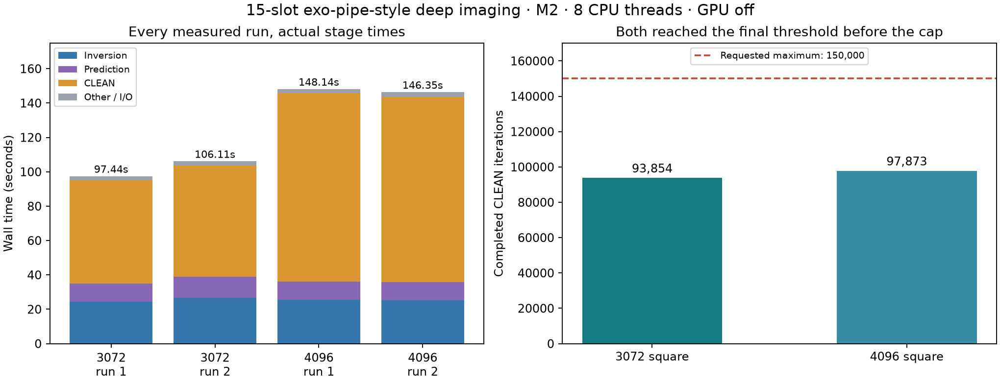
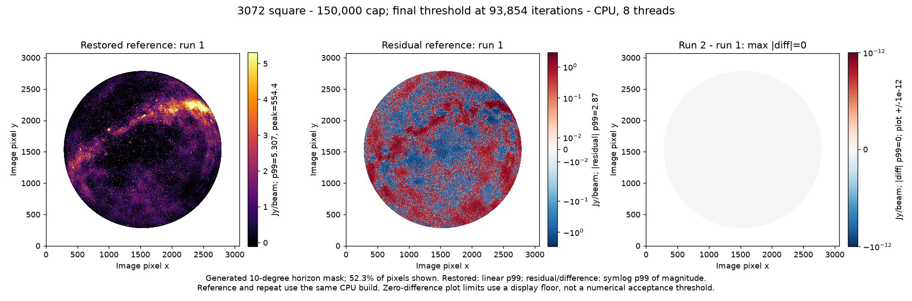
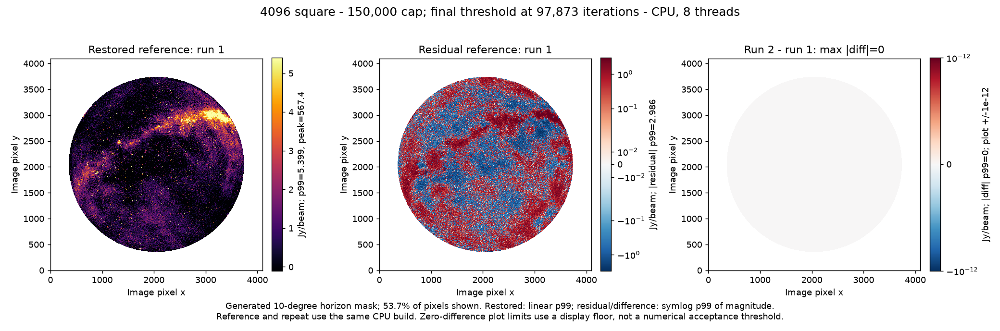

# Exo-pipe-style 15-slot deep imaging at a 150k budget — 2026-10-23

## Default and result

**150,000 CLEAN iterations is now the default maximum for the deep benchmark runners.** Smaller budgets require an explicit per-job or `--niter` override. This changes the deep benchmark configuration, not WSClean's general-purpose CLI default.

On chia (Apple M2, 16 GiB, eight CPU threads, GPU off), all four measured runs reached the configured final threshold before the 150k cap:

| Image | Pixel scale | Wall-time samples | Median | Completed iterations | Major cycles | Stop reason |
|---|---|---|---:|---:|---:|---|
| 3072² | 2.7 arcmin | 97.44, 106.11 s | **101.8 s / 1.70 min** | 93,854 in both runs | 3 | Final threshold reached |
| 4096² | 2 arcmin | 148.14, 146.35 s | **147.2 s / 2.45 min** | 97,873 in both runs | 3 | Final threshold reached |

The requested iteration limit is a budget, not a requirement to keep cleaning after convergence. The last reported iteration and the final cleaned-component total agree in every run.

The previous 26.5 s / 29.8 s measurements used a **20,000-iteration cap and stopped at that cap**. They remain historical capped-run measurements, not converged deep-imaging speed.



## Image panels

These plots read the actual 150k-budget FITS outputs. Each shows the run-1
restored image, its residual, and run-2 minus run-1 restored pixels, using the
generated 10-degree horizon mask. Restored panels are linear and saturated at
p99 (**5.307 / 5.399 Jy/beam** at 3K/4K); residual and difference panels use
symmetric-log magnitude-percentile limits. Peaks are reported rather than used
as display limits. The zero-difference display floor is not an acceptance threshold.





The separate full-array T0 comparisons were rerun before publication: all six
products remain bitwise in both same-size pairs. These are same-build repeats,
not a new legacy-reference or calibrated-photometry acceptance claim.
The publication renderer has RED/GREEN mask/p99 regressions; the full Python
suite now passes **229 tests**, including the two new plotting tests, which also
pass under `-O`. Numerical statistics are in `image-statistics.json`; reproduce
with `.venv/bin/python docs/bench/exo-deep-150k-20261023/plot_images.py`.

## Workload and timing accounting

Input: the protected real 15-integration MS at `bench/out/gpu-audit-20261022-0715/input-15.ms`. Runs were sequential in 3K/4K/4K/3K order. No compilation or heavy tests ran concurrently with these timings. These are WSClean imaging wall times, not full calibration/pipeline elapsed times.

Science settings were unchanged except for the iteration budget:

```text
-j 8 -pol I -multiscale -multiscale-scale-bias 0.8
-niter 150000 -mgain 0.95 -auto-threshold 0.5 -auto-mask 3
-local-rms -horizon-mask 10deg -weight briggs 0 -mem 40
-reorder -no-update-model-required
```

Geometry is the same adapted benchmark geometry as the prior 20k runs, not the original pipeline's 2357-pixel grid. Each run has a fresh output prefix and temporary directory. Dirty/PSF inputs were not reused, so the totals include ordinary initial imaging and subsequent major cycles.

| Median stage | 3072² | 4096² |
|---|---:|---:|
| Inversion | 25.58 s | 25.36 s |
| Prediction | 11.32 s | 10.65 s |
| Deconvolution | 62.58 s | 108.70 s |
| Other / I/O | 2.30 s | 2.54 s |
| Total wall | 101.78 s | 147.25 s |

Stage values come from WSClean's own final timing line; wall time comes from `/usr/bin/time`, not background-process uptime. The plot shows every individual run rather than a synthetic combination of best stage times. Deconvolution accounts for approximately 61.5%/73.8% of these median totals; the shorter 20k profiles should not be assumed representative of this converged workload.

Peak RSS was 2.51 GiB at 3K and 3.98–4.08 GiB at 4K. Only two repeats per size were measured; these samples establish observed runtime, not a universal performance guarantee.

## Verification

- All four WSClean processes exited successfully.
- All six expected products exist: dirty, horizon mask, restored image, model, PSF and residual.
- Both same-size repeat comparisons pass **T0: every FITS data array is bitwise identical**.
- Before/after content hashes and file modes match for all **108 input files / 4,428,203,949 bytes**. No input data was modified.
- The CPU executable is unchanged from the prior repair build: SHA-256 `af07b46ed32b0aee4fa7bf3bb4f98f78859e635a4616fb1db6bf3313dfd3994e`. This task changes benchmark defaults, not imaging arithmetic.
- The original default-change Python suite passed **227 tests**, with **23 relevant tests also passing under Python `-O`**. The image-publication follow-up above adds two plotting tests. No C++ rebuild was needed.
- Independent final review approves the runner/default/metadata changes with no blocking findings. It inspected code and saved evidence; the parent ran the tests and benchmarks.

These are repeatability and convergence checks at the requested budget. They do not reclassify the older legacy-build comparison failures documented in the [CPU repair report](cpu-correctness-repairs-2026-10-22.md).

## Default implementation and explicit overrides

- `bench/gpu_profile_campaign.py`: `DEFAULT_NITER=150000`; plan and receipt metadata record the effective budget. `run_job()` uses this default when no budget is supplied.
- Both profile/resource campaign CLIs accept `--niter`; resource plans also record the selected budget.
- Programmatic override: `make_plan(..., niter=20000)` or an explicit job `niter` field. A second hidden `-niter` in `extra` is rejected before spawning or writing output.
- The bounded per-run timeout is 1,800 seconds. Monitoring/sampling windows cover the same deadline instead of silently cutting off at the older short-run windows.
- Resource plots validate iteration budgets across every plotted phase before rendering. Mixed caps or known/unknown mixtures fail; uniformly unknown legacy metadata is labeled unknown rather than guessed to be 20k.
- Direct `bench/run.sh` remains an argument-preserving wrapper; callers supply imaging options explicitly. WSClean's ordinary CLI behavior is unchanged.

The initial default test was RED at `20000`, then GREEN at `150000`. Review found that plotting originally checked only timing metadata while using trace/overlap data too; that was fixed with cross-phase RED/GREEN tests. Preliminary test-dependency/mock failures and rejected review output are retained. Historical 20k measurements and figures were not relabeled or overwritten; the archived-data render smoke test wrote only to the new raw artifact folder.

## Artifacts

- Compact real measurements, plan and figure script: `docs/bench/exo-deep-150k-20261023/`.
- Raw logs, protected-input manifests, run receipts, exact launcher, tests and reviews: `bench/out/exo-deep-150k-20261023-0555/`.
- FITS products and timing receipts: `bench/out/exo150k-20261023-{3072,4096}-r{1,2}/mx/`.
- Re-render the figure: `.venv/bin/python docs/bench/exo-deep-150k-20261023/plot_results.py`.

Pushes and tracking updates are separate from the benchmark receipts above. No release or merge into `main` is included.
