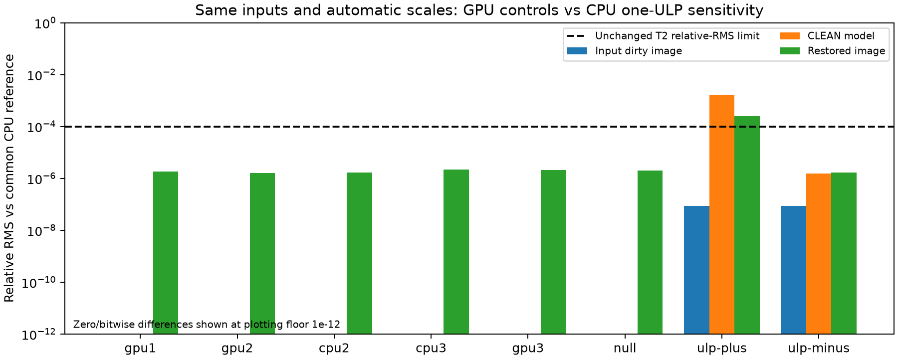

# GPU verification follow-up — quarantine and matched-input controls

## Result and scope

The **GPU-specific matched-input checks pass** on the 15-slot LWA workload.
With identical dirty/PSF inputs and identical automatic multiscale choices,
three CPU runs, three actual-GPU runs and a disabled-GPU null control have
bitwise-identical CLEAN models. All seven pass the unchanged pixel gates;
all three GPU runs and the null control pass the CPU source envelope.

This does **not** erase the original full-pipeline failures: re-evaluating the
retained ten-GPU/ten-CPU family with the corrected comparator still gives
**6/10 passes**. Broader scientific release acceptance remains open. No new
speed claim is made here: the previous measured prediction/wall reductions
remain 20.6%/3.8%. `main` and the published CPU release are unchanged.

## Changes

### Retired inversion is no longer a production path

- Normal Metal linkage excludes the retired inversion/gridder objects.
- `-mgpu` still defaults to prediction only; inversion/degridding remain ducc0.
- Selecting a retired `MX_METAL_ENGINE` with `-mgpu` is explicitly rejected.
- `WSCLEAN_MX_METAL_ARCHIVE=OFF` is the default. Enabling it builds an isolated
  archive library/probe, not an alternative inversion route in WSClean.
- `scripts/test.sh` checks the selected CMake configuration rather than stale
  probe files. Production symbols and CLI refusals are checked for archive OFF
  and ON; the CPU-only executable refuses `-mgpu`.
- `scripts/test_archived_metal.sh` is the explicit historical diagnostic. It
  refuses an archive-OFF build (exit 2). With archive ON it still exits 1:
  analytic/hoisted/packed gridding relative RMS is 17.2/17.4/17.4 against 1e-5.
  This is an unresolved archived failure, not a passing gate or a hidden skip.

### The source-envelope metric is now symmetric

Directional flux ratios and nearest-neighbor associations could reject a
reference member against its own envelope. A synthetic 100-versus-90 flux
fixture reproduced this before the fix. Candidate/reference, reference pairs
and member statistics now consistently use the worst of both directions.
Thresholds, floors and the conservative `max` default are unchanged.

Self-membership, reference-order invariance and asymmetric association tests
pass. All ten retained CPU references pass their own real-data family. The
original GPU verdict remains 6/10, so this correction is not presented as a
fix for those four failures. Cached batch evaluation rejects incomplete
product inventories, changed input stamps and colliding output filenames.

### PSF reuse must retain the theoretical beam

The first common-input experiment exposed a confound: old PSFs did not retain
the theoretical beam. Reuse silently selected 4-pixel instead of 9-pixel first
nonzero scales. Those exploratory runs are retained but **not used to establish
equivalence to the original configuration**.

`WSCTBEAM` now records the effective theoretical beam in radians, separately
from the fitted restoring beam. Reuse restores the beam-fitting seed before
PSF processing. MFS products use the effective MFS beam, not the first channel's
value. A missing legacy keyword warns; present malformed, undefined, nonfinite
or nonpositive values are invalid. Actual CLI regressions reproduced and then
passed malformed/undefined headers and unequal-channel MFS metadata.

The corrected controls all preserve `WSCTBEAM=0.0018508740727208` radians and
all nine original scale/kernel/bias records. Input pixels were not altered to
make CPU/GPU agreement pass; only the explicitly labeled CPU perturbation
controls use `nextafter` on the dirty image.

## Corrected controlled experiment

Same frozen `gpu-followup-beam` executable, 3072² / 2.7amin, eight threads,
20,000 multiscale iterations, Briggs 0, bias 0.8, mgain 0.95, auto-threshold 0.5,
auto-mask 3, local RMS and 10-degree horizon mask. Three CPU and three GPU runs
were interleaved, followed by the null and signed one-ULP CPU controls.
These are correctness experiments, **not new timing measurements**.

Each GPU run submitted and completed 82 planes, used exactly two shared planes,
and reported zero fallback and grid-copy bytes. CPU/null controls reported no
GPU prediction session. Recorded trial identities, roles, fixtures and env
settings must match the predeclared plan; duplicates cannot replace GPU trials.

| Comparison with common CPU reference | Restored-image relative RMS | CLEAN-model relative RMS | Pixel T2 | Source envelope |
|---|---:|---:|---|---|
| CPU reruns | 1.67e-6–2.19e-6 | 0, bitwise | Pass | Reference family |
| Three GPU runs | 1.62e-6–2.14e-6 | 0, bitwise | All pass | All pass |
| Disabled-GPU null | 2.03e-6 | 0, bitwise | Pass | Pass |
| CPU dirty +1 ULP | 2.45e-4 | 1.68e-3 | Fail | Fail |
| CPU dirty -1 ULP | 1.67e-6 | 1.52e-6 | Pass | Fail |

The signed dirty perturbations have relative RMS about 8.72e-8. The positive
perturbation alone changes the model by 0.168% and restored image by 0.0245%.
GPU image/residual differences in the matched-input experiment remain within
the observed CPU-rerun range. Source checks can reject even the negative
one-ULP control whose pixel products pass. These results demonstrate CLEAN
sensitivity and boundary-limited checks; they do not waive a failed gate or
prove every full-pipeline discrepancy harmless.



## Verification and limits

- Active Metal and CPU suites each pass **153 Python tests**, plus their linked
  native numerical regressions. Production GPU activation/execution checks pass.
- The final committed executable passes all six 1024² CPU/GPU T2 products and
  completes 89 GPU planes without fallback/copies. Before/after CPU pixels are
  bitwise identical in all six products. Tapered fresh/reused PSFs preserve
  scale records and the pixel data in all five products bitwise.
- All 108 file hashes remain unchanged in both the read-only benchmark MS and
  original standalone source. Developer WSClean is `7a56f554`; all four patch
  series replay exactly (WSClean 52, aocommon 2, schaapcommon 7, radler 7).
  The delivered snapshot is `bench/bin/gpu-followup-delivered/wsclean`.
  Exact command receipts, hashes and dependencies are in `delivery.json`.
- Archive ON/OFF production quarantine checks pass; archived gridding still
  fails explicitly and is not part of the production linkage.
- Independent review findings were reproduced before their fixes. Parser/MFS,
  batch-name collision and analyzer trial-completeness regressions are retained.
- This does not newly certify all polarizations, multi-MS, Linux/MPI,
  fixture-dependent upstream suites or absolute photometric calibration.
- The frozen snapshot pins WSClean and schaapthreading; other installed dynamic
  dependencies remain shared and are listed in provenance.

## Reproduction and artifacts

Raw evidence is under `bench/out/gpu-followup-20261022-0945/`. No previous raw
runs, failing reports or science MSs were deleted or overwritten.

| Evidence | Location |
|---|---|
| Original nine exploratory controls | `control-plan.json`, `control-runs.json`, `control-gates.json`; beam mismatch caveat above |
| Corrected nine controls | `beam-controls/`, `controls-v2.log`; `bench/out/gpu-causal-v2-*/gpu-followup-beam/` |
| Old family re-gate and self-membership | `regated/` |
| Corrected source gates | `beam-regated/` |
| Archive matrix | `build-matrix.json`, `archived-diagnostic.log` |
| Header regressions | `beam-red.log`, `beam-review-red/`, `beam-review-green/` |
| Independent reviews and fixes | `review*.json`, `review-fix*.md` |
| Final local delivery receipts | `docs/bench/gpu-followup-20261022/delivery.json` |
| Tracked numerical summaries | `docs/bench/gpu-followup-20261022/{causal,source-verdicts}.json` |

Generate the figure from real retained runs with:

```sh
.venv/bin/python bench/analyze_gpu_controls.py \
  bench/out/gpu-followup-20261022-0945/beam-controls \
  docs/bench/gpu-followup-20261022
```

## Next optimization

1. Keep prediction as the only default GPU stage. Do not reopen GPU inversion.
2. Remove measured convolution plan churn with a bounded shape-keyed workspace
   and persistent scale kernels; prove eviction/drain/shape-change correctness
   before measuring repeated whole-program benefit.
3. Consider fused weighting/peak reduction only where transformed images need
   not return to CPU consumers. Keep slower current hooks explicit opt-ins.
4. Broaden calibrated fields and observing modes with their own CPU and
   perturbation controls. Preserve the original strict failures; do not derive
   new acceptance thresholds from a failing GPU result.
