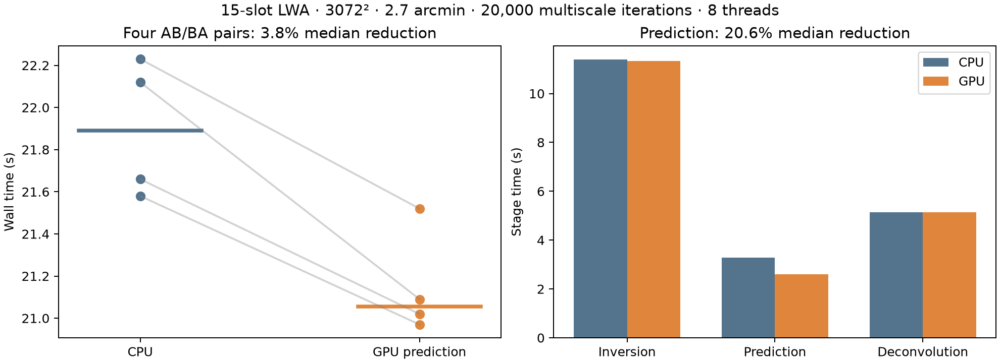
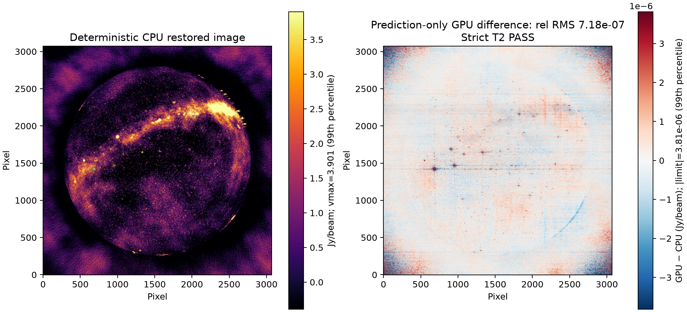
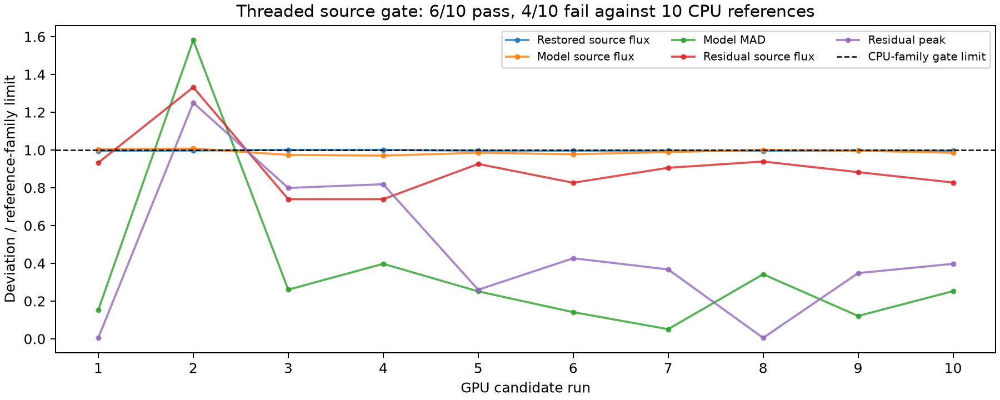

# gpu-dev audit, implementation and next optimization — 2026-10-22

## Verdict

A real, bounded GPU prediction pipeline is implemented and measured. On the
15-slot LWA workload, prediction time fell **20.6%** and total wall time fell
**3.8%**. This is a modest end-to-end gain, not a fully GPU-accelerated WSClean.

**Scientific release acceptance remains open.** Deterministic deep imaging and
fixed-model prediction pass; the conservative threaded source-envelope gate
still fails 4 of 10 candidates. The archived GPU-gridding probe also fails.
The entire Metal suite and all observing modes are not certified. `main` and
the published CPU release are unchanged.

## Corrections to earlier reports

1. `main/main.cpp` did not receive `WSCLEAN_MX_METAL`. Using object files through
   `$<TARGET_OBJECTS:...>` did not propagate the feature definition to main.
   Registration was compiled out; the executable lacked the registered hook
   implementations. The earlier 23.27 s versus approximately 23.5 s comparisons,
   6% peak-hook gain and “all hooks T2 PASS” claims **do not establish GPU work**.
2. The old peak probe copied incorrect negative-component semantics into its
   oracle. It is replaced by tests against actual radler `peak_finder`.
3. Native Metal R2C/C2R works with correct padded in-place storage. The previous
   failed configurations did not justify declaring the backend broken.
4. `vmav` can wrap external shared memory. The old compact `memcpy` assumption
   was unsafe because `build_noncritical` can pad rows. Its reproduced error was
   relative RMS 1.412 before the external-view implementation.
5. Peak scan was roughly 8–11% of deconvolution, not the inclusive 78%.
   A scan microbenchmark cannot justify a multi-fold deconvolution projection.

`docs/bench/gpu-plan-after-inversion.md` is explicitly superseded; its historical
numbers remain visible rather than being erased.

## Implemented changes

| Area | Implementation and evidence |
|---|---|
| Activation | Explicit main compile definition/include path; compile-command and linked-symbol regression; nonzero production execution counters |
| Prediction | Two compact shared complex planes; CPU preparation/degrid overlap asynchronous GPU forward FFTs; ascending consumption; no full-grid copies |
| Failure recovery | Drain a failed slot, re-render and CPU-transform only that plane before consumption; never restart partial visibility accumulation |
| Native real FFT | Rectangular/batched R2C and C2R with `2*(width/2+1)` real-row pitch; GPU frequency product plus batched C2R in one submission |
| Multiscale routing | Real scale kernels, one batch call, preserved masks/RMS processing, original CPU fallback |
| Peak search | Tiled deterministic reduction, signed magnitude, row-major ties, masks, borders, NaN/infinity/no-peak handling; bounded shared scratch |
| Lifetime | Owned configuration storage; drain before teardown; balanced Metal ownership, including shader-compilation error paths |
| CPU compatibility | No hooks without `-mgpu`; CPU-only executable rejects `-mgpu`; CPU-only and hidden/static factory routing tested |

### Effective selection

- **Default `-mgpu`: GPU prediction only.** Inversion and gridding/degridding
  stay on ducc0; deconvolution stays CPU because the measured offloads lost.
- `MX_METAL_CONVOLVE=1`: optional batched multiscale convolution.
- `MX_METAL_PEAK=1`: optional GPU peak scan.
- `MX_METAL_SINGLE_CONVOLVE=1`: optional general single-C2R adapter.
- All require `-mgpu`. `MX_METAL_NO_PREDICT=1`, `MX_METAL_NO_CONVOLVE=1` and
  `MX_METAL_NO_PEAK=1` provide stage ablations.
- `MX_METAL_DEBUG_TIMING=1` prints counters. Default production runs submitted
  and completed 82 prediction planes, with zero fallback/copy bytes.
- Do **not** select the retired `MX_METAL_ENGINE=metal|cpu-vkfft` inversion
  experiments: their archived gridding validation is not green.

## Repeated production timing

Apple M2, 16 GiB RAM; standalone 931,920-row / 15-slot MS; 3072 × 3072,
2.7 arcmin/pixel, Stokes I, Briggs 0, multiscale bias 0.8, 20,000 iterations,
mgain 0.95, auto-threshold 0.5, auto-mask 3, local RMS and 10° horizon mask.
Both variants used **the same frozen executable**, `-j 8`, and the same read-only
input. Two warmups were excluded, followed by four sequential counterbalanced
AB/BA pairs. No builds or heavy tests ran during measurement.

| Median | CPU | `-mgpu` | Interpretation |
|---|---:|---:|---|
| Wall | 21.890 s | 21.055 s | 3.8% less time |
| Inversion | 11.388 s | 11.340 s | unchanged CPU path; small run variation |
| Prediction | 3.275 s | 2.599 s | 20.6% less time |
| Deconvolution | 5.135 s | 5.135 s | unchanged CPU path |
| Peak RSS | 2657 MiB | 2640 MiB | no demonstrated process-RSS penalty in this cohort |

CPU walls: 21.58, 21.66, 22.12, 22.23 s. GPU walls: 20.97, 21.02, 21.09,
21.52 s. GPU won every pair. Instructions/cycles, load, swap, commands and stage
times are retained. Stage medians are not summed into a fictional run. The later
six-pair science follow-up remains separate from this initial timing claim.

### Why deconvolution remains opt-in

The real-device peak probe passed, but its 3072² × 4 end-to-end median was
10.575 ms versus 8.645 ms for the serial CPU oracle. Kernel-only timing excluded
copies and serialized callers.

Production ablations gave deconvolution approximately 6.65–6.73 s with batched
GPU convolution versus approximately 5.10 s on CPU. These are diagnostic single
runs, not the repeated cohort above. A separate profile measured:

| Batch-convolution cost | Time |
|---|---:|
| 21 plan creations across 22 calls | 0.676 s |
| Execution including input preparation/upload and waiting | 1.150 s |
| Of that execution: GPU command timestamps | 0.374 s |
| Output readback/copy | 0.417 s |

Do not add GPU timestamps again to execution time. Allocation, plan churn and
memory movement dominate this integration. Enabling it by default would discard
the prediction win.

## Numerical and scientific verification

| Check | Actual result |
|---|---|
| GPU prediction differential | 12 supported cases, 681 completed GPU planes, zero fallback/copy bytes; CPU-only impostor rejected |
| Production-size prediction grid | 3960², shifted sources: relative RMS 2.12e-7; max/peak 3.26e-7 |
| **Identical-model CLI prediction on the real MS** | All **178,928,640 complex MODEL_DATA cells**, 931,920 rows: relative RMS **5.90e-7**, max/peak **7.01e-7**; 82 actual GPU planes |
| Native real FFT, 3072² × 8 | Forward 5.62e-7, inverse 7.09e-7 relative error; convolution 6.17e-7 |
| Real multiscale kernels | Tapered-quadratic and Gaussian, square/rectangular, eight scales: pass |
| Peak oracle | Adversarial real-radler cases, concurrent first use, ties, masks, signed values and nonfinites: pass |
| Mock failure/lifetime | Submit/completion failure, refusal and abandoned work: pass; at most two outstanding planes, no remaining live sessions |
| Deterministic deep CPU rerun | All six FITS products bitwise identical (`-j 1`) |
| Deterministic deep CPU/GPU | All six products pass unchanged T2 limits; dirty/PSF/model/mask bitwise; restored image 7.18e-7, residual 9.45e-7 relative RMS |
| Threaded strict pixels | Cleaned image/model/residual fail single-reference T2; CPU reruns also fail some pairs; failures retained |
| Threaded source envelope | Initial 0/4 pass; balanced 10 CPU + 10 GPU follow-up gives **6/10 pass, 4/10 fail**, unchanged conservative `max` criterion |
| Input integrity | Benchmark copy and original standalone 15-slot source: all 108 file hashes unchanged; benchmark input remains read-only |

The identical-model test predicts only into two **new writable disposable
clones**, never a science input. Comparing their complete MODEL_DATA columns
isolates prediction from different CLEAN models.

For this one-major-cycle workload, `WSClean::WriteModelImages` runs before the
first prediction (`main/wsclean.cpp`, lines 1446–1448 and the subsequent
prediction branch). Differences already present in the saved models therefore
predate GPU FFT execution. This is not permission to waive downstream gates.
The expanded family reproduces larger CPU CLEAN basins, but some conservative
checks still fail: model source-flux spread, one model MAD and residual check,
and marginal restored-source flux checks. No threshold was relaxed. Broader
controlled scientific acceptance remains required before a release claim.

### Suite status — not blanket green

- **CPU:** 136 Python tests and the linked native regression suite pass.
- **Metal:** the same 136 Python tests and new prediction/peak/real-FFT/multiscale
  gates pass. The **archived analytic/hoisted/packed GPU-gridding probe fails**;
  the aggregate suite intentionally returns nonzero while collecting remaining
  gates. This unresolved failure is not hidden by a skip.
- Activation, padded-stride and execution-proof RED/GREEN evidence is retained.
- Independent review found a shader-error ownership leak, fixed separately and
  re-reviewed. Final review reports no remaining concrete security/logic
  findings; parent tools performed the actual tests.
- Fixture-dependent upstream/dependency suites, Linux/MPI, all polarization and
  multi-MS combinations, and absolute flux calibration are **not** newly certified.

## Prioritized next-optimization plan

| Priority | Work | Acceptance criterion |
|---|---|---|
| P0 | Resolve threaded boundaries with a predeclared larger CPU/GPU family and known-small CPU perturbation control | Preserve failures; judge against CPU/control distributions, not a tolerance widened from GPU results |
| P0 | Quarantine or repair retired inversion entry points/probe | No ambiguous selectable path that fails its own oracle; do not silently remove the gate |
| P1 | Keep scale kernels and reusable FFT workspaces resident with a hard aggregate-byte budget | Remove measured plan/allocation churn without lifetime or shape-key bugs; repeated production benefit |
| P1 | Fuse convolution, RMS weighting and peak reduction when the CPU does not require transformed images | Avoid output-copy plus peak-upload; preserve masks, ties and cached-residual consumers; real radler and end-to-end gates |
| P2 | Reuse the bounded two prediction plans across compatible calls | Separate cold planning from warm execution; safe draining/eviction and total memory bound |
| P2 | Broaden workloads and portability | Frequencies/layouts/thread counts; explicit CPU-only/MPI behavior; numerical gates before timing |

Do not resume a scalar GPU gridding/degridding port. Inversion stays ducc0.
Do not extrapolate microkernel gains to total WSClean speed.

## Artifacts and reproducibility

- Measured frozen executable: `bench/bin/gpu-audit-final/wsclean`.
- Final rebuilt executable: `build-mx-metal/wsclean` (`mx-base-50-g0dbb1b06`);
  frozen as `bench/bin/gpu-audit-delivered/wsclean`. Its 1024² / 8.1amin,
  200-iteration, single-thread CLI check passes all six T2 products and records
  89 completed GPU prediction planes, zero fallback/copy bytes.
- Logs, raw runs, manifests and commands: `bench/out/gpu-audit-20261022-0715/`.
- Tracked summaries/figures: `docs/bench/gpu-audit-20261022/`.
- Figure generator: `.venv/bin/python bench/analyze_gpu_audit.py`.
- GPU execution gate: `.venv/bin/python tests/prediction_gpu_check.py build-mx-metal/metal/mx-prediction-gpu-probe`.
- Snapshot freezes WSClean and schaapthreading; other installed non-system
  dependencies remain shared. Provenance records this limitation.
- Developer commits: WSClean `0dbb1b06`, schaapcommon `8bb0759`, radler `39d58d1`.
  Exported series: WSClean 50, schaapcommon 7, radler 7, aocommon 2 patches;
  each replays from `mx-base` to its exact developer HEAD using an isolated
  index. Historical vendor whitespace warnings are not replay failures.
- Local root branch is `gpu-dev`; no push, release, main merge or external
  tracking publication is implied.
