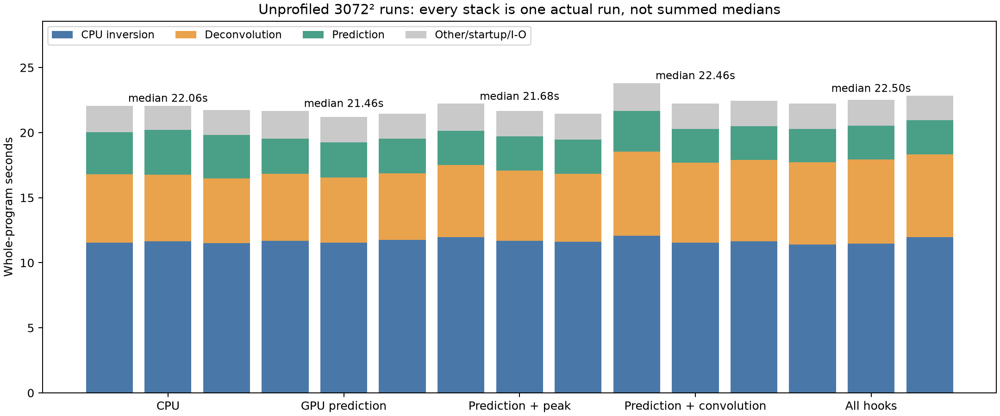
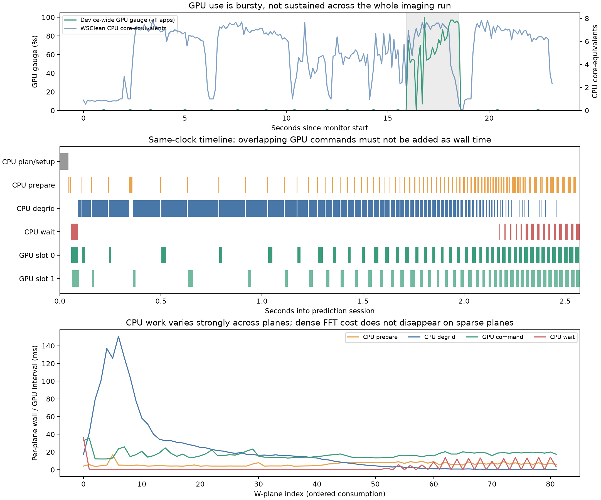
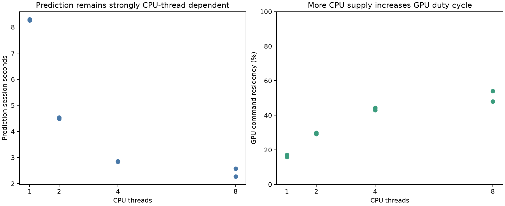
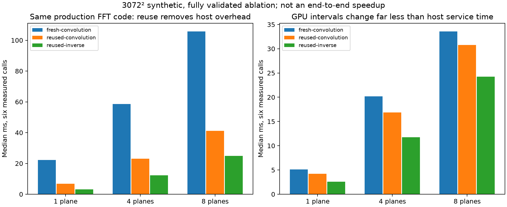
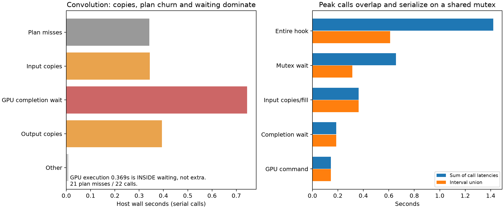

# GPU profiling and utilization audit — 2026-10-22

## Executive finding

**The current pipeline is primarily CPU-fed and synchronization/data-movement
limited, not continuously limited by GPU arithmetic.** This conclusion is
supported by real command timestamps, host spans, device gauges, CPU samples,
thread scaling and a separate resource-reuse ablation—not by GPU utilization
percentage alone.

1. Default GPU prediction spends only **48–54% of its session** inside the union
   of GPU command intervals. Those intervals occupy roughly **5–6% of the whole
   imaging run**. CPU degridding is the largest prediction component.
2. Experimental convolution repeatedly discards its plan/resources: **21 misses
   in 22 calls**, **4.004 GB input copies** and **3.171 GB output copies**.
   Fresh-resource dispatch delays are substantial. Reusing the same production
   FFT plan/buffers greatly reduces host service time in a controlled ablation.
3. Experimental peak finding adds **3.964 GB of host copies/fills** and serializes
   callers on a shared mutex. Its GPU reduction is not the main cost.
4. A 4K all-hooks run encountered the batch memory limit and system memory
   pressure. Raising the limit or caching every shape is not a safe first fix.
5. The remaining whole-program cost is mostly CPU inversion and CLEAN. These
   account for about **78%** of the default-GPU run in this timing cohort.
   Inversion remains ducc0; this audit does not reopen the retired GPU gridder.

No optimization is claimed as delivered here. The changes add optional
instrumentation, validated analysis and reproducible profiling tools.

## 1. Hardware, workload and measurement scope

- Apple M2, **8 CPU cores, 8 GPU cores, 16 GiB unified memory**.
- Baseline: root `cd026f5`, developer WSClean `7a56f554`;
  frozen `bench/bin/gpu-followup-delivered/wsclean`.
- Instrumented snapshot: `bench/bin/gpu-profile-v1/wsclean`.
- Read-only 15-slot LWA MS: 931,920 stored rows; ducc0 logs 926,640 selected rows.
- Main case: 3072², 2.7 arcmin/pixel, `-j 8`, Stokes I, Briggs 0,
  multiscale bias 0.8, 20,000 iterations, mgain 0.95, auto-threshold 0.5,
  auto-mask 3, local RMS, 10-degree horizon mask, `-mem 40 -reorder`.
- 4K case: **4096² / 2 arcmin/pixel**, not the 3K pixel scale.
- **52 completed WSClean runs** across declared phases, including five excluded
  timing warmups; the principal timing table has three measured runs per mode.
  Two failed PID-discovery pilots and a diagnostic run are retained separately
  and excluded. The successful `pilot3` supplies initial trace calibration.
- Final micro-ablation: **63 GPU calls**, nine excluded warmups and 54 measured
  calls. Every real output cell in every batch plane was numerically checked.

Workloads ran sequentially. No compilation or other GPU benchmark ran during
measurement. Profiling, CPU sampling and ordinary timings are separate cohorts.
The desktop remained in normal use; no applications were killed, caches purged,
priorities changed or privileged settings modified.

### What was and was not measured

| Measurement | Scope and interpretation |
|---|---|
| Metal `GPUStartTime`/`GPUEndTime` | Completed command-buffer execution intervals on the host clock; includes execution latency/stalls, **not shader occupancy** |
| Host spans | Mach absolute timestamps around preparation, degridding, planning, copies, encoding, waits and reduction |
| IORegistry gauges, 100 ms | Device-wide GPU/renderer/tiler activity and memory gauges; includes other apps and an undocumented driver averaging window |
| `proc_pid_rusage` | Selected WSClean process CPU time, instructions/cycles, RSS/footprint, page-ins and physical I/O counters |
| `/usr/bin/time -lp` | Actual program wall/user/system time, peak RSS and hardware counts |
| `/usr/bin/sample` | Separate whole-process CPU stack samples; parked worker samples are not CPU-time percentages |
| Explicit byte counts | Host copies/fills and workspace sizes; **not measured DRAM traffic or PCIe transfers** |

This installation has no `xctrace`/Instruments. `powermetrics` requires root and
noninteractive authorization was unavailable. The standard Metal counter-set
query returned **timestamp only**, with stage-boundary sampling supported and
dispatch-boundary sampling unsupported. **GPU frequency, power, ALU occupancy,
cache misses and hardware memory bandwidth were not measured.** Their absence
must not be represented as zero or as proof of a compute/memory hardware limit.

CPU and Metal intervals use the same host time domain. The 681 completed GPU
commands in the production prediction probe were bracketed by their encode and
wait records with no clock-domain failures. CPU rusage fields were calibrated:
they are **Mach ticks, not nanoseconds**; a 0.350 s CPU workload measured
0.348 s after conversion. The sampler's initial median query cost was about
0.17 ms per 100 ms interval.

## 2. Unprofiled whole-program results

Same frozen baseline executable for every mode. One warmup per mode was excluded;
mode order was reversed on alternating repetitions. Values below are medians;
stage medians are **not** added to manufacture a hypothetical run.

| Mode | Wall s | Prediction s | Deconvolution s | Inversion s |
|---|---:|---:|---:|---:|
| CPU | 22.06 | 3.330 | 5.092 | 11.536 |
| GPU prediction, default | **21.46** | **2.676** | 5.113 | 11.684 |
| Prediction + GPU peak | 21.68 | 2.617 | 5.396 | 11.684 |
| Prediction + GPU convolution | 22.46 | 2.602 | 6.243 | 11.656 |
| Prediction + both hooks | 22.50 | 2.579 | 6.376 | 11.466 |

The existing prediction pipeline reduces median prediction time by **19.65%**
and wall time by **2.72%** in this cohort. This is a fresh measurement of the
existing implementation, not a gain caused by the instrumentation. The earlier
20.6%/3.8% cohort remains a separate measurement.

Activating more GPU hooks increases GPU work but does not improve total time.
The convolution path is the clearest regression. Raw samples, ranges, CPU
core-equivalents and memory are in `results.json`.



## 3. Prediction: the GPU is mostly waiting for CPU supply

Two later 3K prediction-only traces give:

| Component | Measured host wall seconds |
|---|---:|
| Entire prediction session | 2.271–2.573 |
| CPU prepare / w-screen and grid preparation | 0.460–0.505 |
| **CPU consume / degridding** | **1.551–1.817** |
| Host wait for GPU completion | 0.196–0.206 |
| Plan initialization, warm driver/cache state | 0.042–0.043 |
| Encode/commit | 0.004 |
| Remaining session bookkeeping | 0.008 |
| GPU command interval union, overlapping host work | **1.228–1.233** |

The WSClean prediction timer also contains **0.385–0.593 s outside the traced
session** in these runs. That remainder includes surrounding provider/setup,
resampling and teardown work; it is not separately attributed by these session
spans, and must not be silently assigned to GPU execution.

The GPU interval row is **not an additional host component**. It overlaps
preparation/degridding/waiting. Summing GPU commands also overcounts overlap
between the two slots; use their interval union.

Approximately **97–98% of GPU-idle time inside these sessions has no pending
command ready for GPU execution**. Only 23–34 ms of the idle interval has queued
work waiting to start. That distinguishes CPU supply gaps from a large general
GPU scheduling backlog.

The workload is strongly uneven across w-planes. In the later representative
trace, the first ten planes account for **52.9% of CPU degridding wall time**;
the last twenty account for only **0.54%**. Conversely, those last twenty
account for **67.5% of host GPU-wait time**. Dense FFT work remains even when
that plane's degridding work is small. The early CPU-heavy region starves the
GPU; the sparse tail exposes GPU completion latency.

The initial pilot's plan setup was 0.371 s, including 0.318 s in the vkFFT
planner. Later warm-cache traces are much cheaper. Do not project the first
process/shape initialization cost onto every steady-state prediction call.



### Thread-count experiment

The internal prediction FFT grid remained **3960²** throughout this sweep.
These are profiled observations, not a new optimized-build speed comparison.

| CPU threads | Prediction-session seconds, two runs | GPU command residency |
|---:|---:|---:|
| 1 | 8.257, 8.293 | 16–17% |
| 2 | 4.530, 4.489 | 29–30% |
| 4 | 2.840, 2.857 | 43–44% |
| 8 | 2.271, 2.573 | 48–54% |

More CPU supply substantially increases GPU duty cycle. Eight threads remain
the best of these tested settings; this does not prove an unlimited scaling law.

Holding CPU work and scheduling fixed, completely eliminating the observed
GPU wait would recover only about 0.2 s in this prediction session—under 1% of
the whole 3K run. This is a conditional critical-path bound, not a universal
bound: changes that also reduce contention or CPU work can have other effects.



## 4. Convolution: plan churn, copies and fresh-resource dispatch latency

The production trace executes **22 batches / 84 planes** and recreates its
single cached plan **21 times**. Batch counts vary; caching only the most recent
`(width,height,count)` discards reusable shapes.

A later convolution-only trace has this host service budget:

| Cost | Seconds |
|---|---:|
| Plan misses / reinitialization | 0.342 |
| Copy input spectrum and kernels | 0.344 |
| Encode/commit | 0.004 |
| Completion wait | 0.744 |
| Copy output rows back to CPU images | 0.394 |
| Other | about 0.005 |
| **Total hook wall time** | **1.832** |
| GPU execution, contained within the above | **0.369** |

The earlier trace paid 0.747 s for plan misses and 2.273 s total. Runtime shader
compilation for the product kernel is not the steady-state main cost: its later
trace total is below 1 ms across 21 creations. Host batch-mutex waiting is
negligible here.

Explicit copies total **7.175 GB** per run:
- input spectrum plus kernels: **4,003,971,072 bytes**;
- output rows: **3,170,893,824 bytes**.

These are CPU copies through unified/shared memory, not PCIe upload/download
measurements. The byte counts do not establish DRAM saturation.

Most fresh convolution commands wait roughly **8–54 ms between encode/commit
completion and GPU start**, depending on batch size and run. The one immediately
reused two-plane plan waits only about **0.35 ms**. The large completion-wait
budget therefore cannot be interpreted as GPU arithmetic time. Precise driver
internals such as resource mapping or coherency preparation are not observable
with the available counters; those remain hypotheses.

### Causal reuse ablation on the same production FFT implementation

This separately linked probe uses the production `mxvkfft.cpp.o`, a dense
spectrum derived from deterministic real input and delta kernels. Each mode
has an excluded warmup and six measured calls in counterbalanced order.
Every real output cell in every batch plane passes the predeclared numerical
limits (worst relative RMS approximately 1.02e-6).

| Batch at 3072² | Fresh: init + submit/wait ms | Reused: submit/wait ms | Fresh GPU ms | Reused GPU ms |
|---:|---:|---:|---:|---:|
| 1 | 22.31 | 6.78 | 5.12 | 4.22 |
| 4 | 58.57 | 22.99 | 20.20 | 16.84 |
| 8 | **105.80** | **41.24** | **33.59** | **30.76** |

The host service reduction is far larger than the GPU-time reduction. This
confirms substantial fresh-plan/resource/dispatch overhead rather than merely
suggesting it from a profile.

Warm inverse-only GPU medians are 2.56, 11.73 and 24.27 ms for batches 1/4/8.
Those are workload ablations, **not exact isolated product-kernel durations**:
cache and scheduling state differ. Setup, inverse CPU preparation, validation,
output destination copying and fresh teardown are not all included in the
micro timing. This is **not an end-to-end speedup claim**. The first probe version
is retained; the final version hoists a repeated buffer getter out of excluded
CPU preparation to avoid an incidental long idle interval before inverse work.



## 5. Peak finding: host copies and serialization outweigh the reduction

Peak-only traces record **84 successful GPU calls**, no declines, and
**3,963,617,280 bytes** of input copies/mask fills. Typical totals:

- host copy/fill: **0.330–0.363 s**;
- GPU command intervals: **0.145–0.159 s**;
- completion waits: **0.187–0.213 s**, including GPU execution;
- CPU final reduction: only about **20 microseconds** total;
- mutex-wait sums: **0.656–0.783 s**, but their interval unions are only
  **0.313–0.340 s**, because callers wait concurrently;
- whole-hook call-latency sums: **1.420–2.095 s**; whole-hook interval unions:
  **0.610–0.690 s**.

Do not sum overlapping mutex waits or interpret all caller latencies as elapsed
CLEAN time. The shared mutex protects shared GPU scratch correctly, but it also
serializes worker requests. Tuning the tiny final CPU reduction cannot fix this.



## 6. 4K: internal grid reduction and memory pressure matter

A 4096² output is not automatically a 4096² working image or a larger prediction
FFT. With the normal minimum-grid-resolution optimization, logs show:

```text
nthreads=8, dirty=(2616x2616), grid=(3960x3960x81), supp=7
```

Thus the default 4K output retains almost the same prediction grid as the 3K
case. Much of the extra output-size cost lies elsewhere, including CLEAN and
resampling. Two unprofiled CPU walls were **29.79/30.43 s** and GPU-prediction
walls **27.28/28.45 s**, but this phase includes system swap activity; treat these
as observations, not a clean new speedup certificate.

The 4K all-hooks diagnostic reports:

- convolution: **16 accepted batches / 44 planes**, 14 plan creations and
  **one refusal at the 512 MiB FFT workspace limit**;
- peak: 52 successful calls;
- wall: 32.09 s;
- system swap usage: **1867.19 → 3072.25 MiB** during the run, with 77,124
  swap-out pages recorded.

This is evidence of system memory pressure, not a per-process accounting of
every swapped byte. It argues against unbounded shape caches or simply raising
the workspace cap.

A separate, explicitly labeled `-no-min-grid-resolution` diagnostic produces
an actual **6160² prediction FFT grid**. Its session is 3.774 s, GPU command
union 2.525 s (**66.9% residency**), CPU preparation 1.349 s and degridding
1.523 s. Whole-run wall is 32.93 s, including 17.538 s of CPU inversion and
8.642 s of CLEAN. Making the GPU busier by forcing more work does not make the
pipeline faster. This single cold-shape diagnostic is not a matched timing
comparison or a recommended production flag.

## 7. CPU samples and profiler overhead

Independent `sample` runs corroborate the host-side diagnosis. Prominent active
leaf symbols include `x2grid_c_helper<7,true>` (inversion), `grid2x_c_helper`
(prediction degridding), ducc0 FFT input/output rearrangement and `sincosf`.
The all-hooks sample increases host memory-move samples while reducing some
CPU convolution work. Raw reports are preserved.

`__psynch_cvwait` dominates all-thread counts because worker pools park threads.
It is **not** a claim that the application spends that fraction of its useful
CPU time stalled. Top-of-stack counts are distinguished from inclusive stacks;
thread records are grouped by numeric thread ID, not merely the first thread
label. See `derived.json` for the retained top symbols and counts.

The profiler-on/off pairs use identical common dirty/PSF input, commands and
auxiliary logging; only `MX_METAL_PROFILE` differs. Their wall differences are
**+0.19, +1.15, -0.99 s**. The mixed signs and phase-wide variability do not
support a precise overhead percentage. This phase followed memory-pressure
runs. Numerical products all pass unchanged T2 limits, but profiling timings
must not replace the uninstrumented performance cohort. Plan/setup spans also
show real cold-versus-warm effects. No overhead correction was subtracted from
measurements.

## 8. Ranked optimization targets

| Priority | Target | Evidence and acceptance condition |
|---|---|---|
| 1 | Reuse convolution plans **and underlying resources** | 21/22 misses; cold/reused ablation removes most host service overhead. Use a bounded pool/cache and test eviction, shape changes, concurrency and draining. |
| 1 | Keep immutable scale kernels resident; avoid redundant full-image copies | 7.175 GB convolution copies plus 3.964 GB peak copies/fills. Identify actual data lifetime and revision, not pointer identity alone. |
| 2 | Fuse convolution, RMS weighting and peak extraction where callers permit | Avoid GPU→CPU copy followed by CPU→shared-buffer copy. Preserve masks, ties and any CPU consumer needing full transformed images. |
| 2 | Respect a **total unified-memory budget** | Count FFT, kernel, input, output, peak scratch and all in-flight buffers—not only one FFT allocation. 4K already reaches a cap and swap pressure. |
| 3 | Improve prediction CPU supply / safe bounded look-ahead | CPU degridding dominates; late sparse planes expose waiting. More queue depth alone has a small observed critical-path budget and consumes more memory. Keep ducc0 SIMD degridding and ordered visibility updates. |
| Later | Tune FFT kernels with shader-level counters | First remove host overhead. Use Xcode Metal tools for occupancy/cache/bandwidth analysis; current timestamps cannot settle those hardware limits. |

Do not add these potential savings together as a promised speedup. Some costs
overlap, some data must return to CPU consumers, and an unbounded cache could
lose more to memory pressure than it saves. A cache/residency prototype needs
fresh paired timing and the existing numerical/scientific gates.

## 9. Validation, provenance and reproduction

- Profiling is opt-in with `MX_METAL_PROFILE=1`; disabled mode emits no profile
  spans. No GPU shader math or production scheduling order was changed.
- **179 Python tests** pass, alongside real production prediction probes, active
  Metal and CPU native regressions, activation/quarantine checks, trace
  invariants and on/off FITS gates. The final rebuilt snapshot completes 89 GPU
  planes with no fallback/copies and passes all six 1024² CPU/GPU T2 products.
- All 108 file hashes remain unchanged in both the benchmark MS and original
  standalone source. No science input was predicted into or made writable.
- The original conservative full-pipeline source-family failures remain open;
  this profiling task does not recertify scientific release acceptance.
- Final source/patch/binary provenance and exact test counts are recorded in
  `docs/bench/gpu-profile-20261022/delivery.json`.
- Snapshots freeze WSClean and schaapthreading; other installed dependencies
  remain shared. This is not a fully vendored dependency closure.

Raw commands, receipts, traces, utilization samples, stack samples, failed pilots,
capability probes and micro-ablation records:
`bench/out/gpu-profile-20261022-1147/`.

Tracked analysis:

```sh
.venv/bin/python bench/analyze_gpu_profile.py docs/bench/gpu-profile-20261022
.venv/bin/python bench/plot_gpu_profile.py docs/bench/gpu-profile-20261022
.venv/bin/python bench/summarize_gpu_profile.py
```

`bench/gpu_profile_campaign.py` describes the declared experiment phases and
fresh-output policy. Existing tags are never reused. The monitor is in
`bench/gpu_monitor.mm`; its tick calibration and failed nanosecond interpretation
are retained. A failed sampler now fails the campaign after saving its receipt.
The actual three CPU samples exited successfully.

### Primary API references

- Apple: [MTLCommandBuffer GPUStartTime](https://developer.apple.com/documentation/metal/mtlcommandbuffer/gpustarttime), retrieved payload retained as `apple-gpu-start.json`.
- Apple: [Optimize Metal apps and games with GPU counters](https://developer.apple.com/videos/play/wwdc2020/10603/), for the distinction between activity, occupancy and hardware limiters.
- Local SDK `sys/resource.h`, Metal capability probe and controlled CPU-time
  calibration establish the platform fields actually available in this run.
