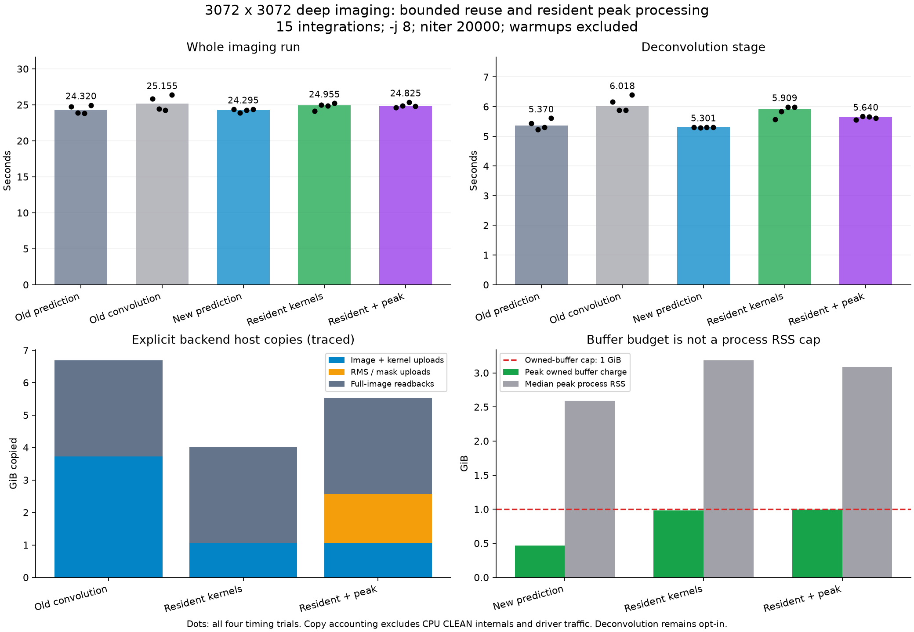
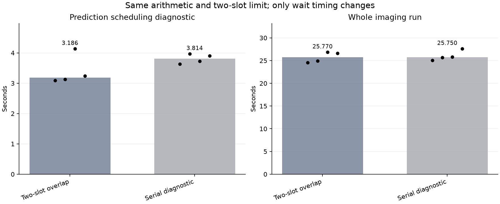
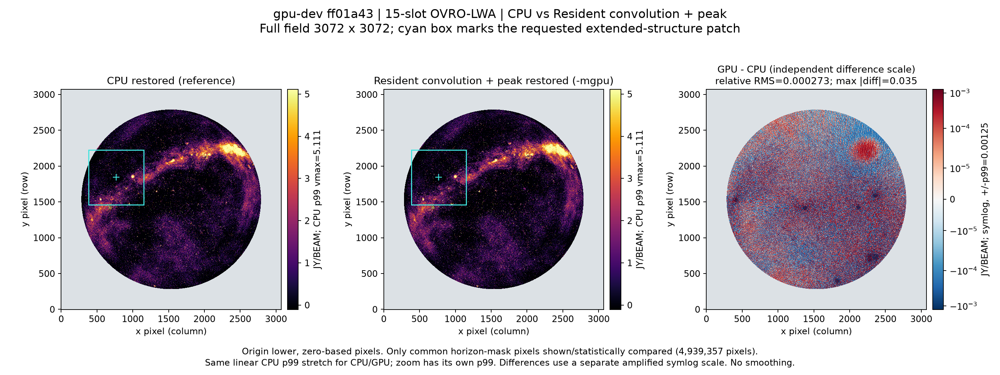
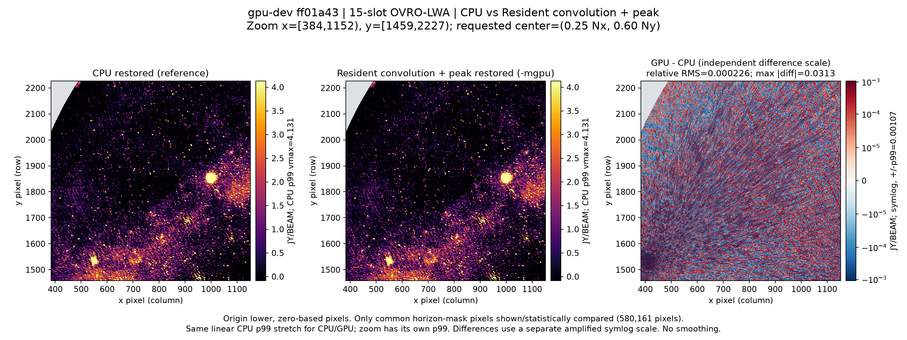

# GPU resource/residency optimization round

## Scope and fixed baseline

Implement the four requested areas on `gpu-dev`: bounded plan/buffer reuse,
immutable scale-kernel residency, eligible convolution/weighting/peak fusion,
and aggregate backend memory accounting followed by a bounded-overlap study.
Inversion and SIMD degridding remain ducc0. `main`/CPU release are unchanged.

- Root baseline: `05b8dde` (publication-only after imaging code `25725da`).
- WSClean developer baseline: `c782c93c9402b8b198626320ce55f8565b671abf`.
- Frozen baseline: `bench/bin/gpu-profile-delivered/wsclean`, SHA-256
  `744bc73a6d1f7a68f33708e0cde598f7cfffbcb383be201a9d499969bb9f17c1`.
- Protected input: `bench/out/gpu-audit-20261022-0715/input-15.ms`;
  15 real integrations, 931,920 stored / 926,640 cross-correlation rows.
- Evidence directory: `bench/out/gpu-opt-20261022-153051/`.
- Baseline failures stay visible: earlier source family 6/10; latest 3K
  full-pipeline T2 pairs 1/3 fail cleaned products, pair 2 passes; archived
  inversion diagnostic remains excluded and failing.

## Design constraints and rationale

| Area | Required design | Why |
|---|---|---|
| FFT resources | Bounded exact-shape LRU/capacity pool, pins for active work; drain before reuse/eviction | Existing single-entry cache misses 21/22 calls; fresh plans incur large host/resource latency |
| Kernels | Immutable owner/revision identities; dimension-aware resident cache; mutable/unknown inputs uncached | Raw pointer reuse is not proof of unchanged bytes |
| Fusion | Weight and reduce resident C2R output with correct padded strides, per-scale masks/borders and exact peak policy | Avoid uploading CPU-weighted copies of an image just produced on GPU |
| CPU consumers | Preserve requested unweighted transformed images; retain CPU sequential RMS computation or refuse fusion where needed | Multiscale CLEAN reuses convolved residuals; eliminating required readback changes the algorithm |
| Memory | One aggregate budget for all backend-owned live buffers: plans, vendor FFT scratch/LUTs, input, resident kernels, output, peak scratch and prediction slots | Per-plan limits do not prevent multiple caches from exhausting unified memory |
| Prediction | Preserve two-slot ordered consume/update pipeline; add a serial diagnostic before considering additional queue depth | CPU supply dominates; increased residency alone is not a speedup |

The backend budget is not a hard cap on whole-process RSS or driver shader/pipeline
allocations. Scope accounted bytes explicitly and also measure process RSS and
system swap deltas. Do not silently claim all unified-memory use is controllable.
Default owned-buffer budget is at most 1 GiB; any configuration override must be
validated, bounded and observable. Lower budgets must decline safely, not raise
limits or corrupt partial results. Idle cache entries should not starve prediction.

GPU deconvolution remains opt-in. Feature ablations must allow separating plan
reuse, kernel residency and fusion, while retaining the same budget. Normal CPU
mode must register no GPU hooks. New controls and exact accounting details will
be recorded after implementation inspection, before measurement.

## Acceptance gates (predeclared)

1. Native resource tests: shape revisit/hit; eviction and cap refusal; concurrency;
   in-flight drain; immutable-generation changes and address reuse; unchanged
   input/output on decline; no retained-byte accounting leak after teardown.
2. Linked production FFT/convolution tests retain existing tolerances. Reuse-only
   paths are compared bitwise where the operations remain identical.
3. Fusion peak selection is checked against **actual radler peak_finder** on
   identical transformed pixels: exact positions, signs, tie order, optional/no
   peak, masks, weighted/unweighted paths, borders, nonfinites and tiny values.
   CPU-versus-GPU FFT error is a separate test, not an excuse to weaken peak tests.
4. CPU-only and Metal production builds and real CLI activation/fallback checks.
   A compiled flag, preflight or CPU fallback does not count as completed GPU work.
5. All FITS products compared for deterministic 1024² `-j1` runs and matched
   dirty/PSF/beam 3072² controls. Full end-to-end failures remain failures; no
   threshold adjustment, data replacement or best-agreement image selection.
6. Sequential counterbalanced timing: baseline and candidate, identical input/
   arguments, excluded warmups, all samples retained. No simultaneous builds or
   heavyweight tests. Separate traces attribute cache misses, copies, memory,
   command intervals and CPU supply. Image 4096² uses **2 arcmin/pixel**.
7. Budget stress and 4K fallback: no oversubscription of the documented accounted
   buffers; no deadlock or stale output; record refusal, RSS and swap evidence.
8. Prediction serial-versus-two-slot diagnostic measures bounded overlap using
   unchanged arithmetic and ordered visibility updates; no speculative queue-depth
   increase without demonstrated critical-path benefit.
9. Independent code review, exact patch replay for every changed developer tree,
   rebuilt delivered executable, protected-input hashes and a durable result report
   with plots. No new release/scientific-acceptance claim from a synthetic benchmark.

## Measurement and artifact ownership

The implementation worker owns active Metal code, narrowly needed radler hooks
and native probes. The parent owns the campaign, real GPU/MS execution, analysis,
reporting, source commits/export/replay and final notification. No original MS is
predicted into, no pristine upstream source is edited, and no prior output is
removed. The implementation worker stops builds before the timing campaign starts.

## Implemented scope and verification

The implementation is committed in the developer trees: WSClean `ff01a434`,
Radler `ea55b61`. The frozen executable is `bench/bin/gpu-resource-v1/wsclean`.
All four exported component trees replay exactly. The CPU release and `main`
remain unchanged; `-mgpu` still defaults to prediction only.

- Convolution retains at most four exact-shape plans with their buffers.
- A shared, 64-entry immutable-kernel cache uses detached published owners and
  monotonic generations; mutable inputs have no reusable identity. Pinned-full
  caches serve new entries uncached rather than exceeding the entry limit.
- Eligible weighted-peak processing reads resident padded inverse-FFT output.
  It preserves row-major ties, masks, signed values and the ARM scalar oracle's
  OptionalNumber behavior. Fusion is explicitly restricted to that architecture.
- Required CPU images remain unweighted. RMS is computed by the original
  sequential CPU accumulation; metadata-only calls skip full-image readback.
- Fusion currently uses two ordered GPU submissions, not a single command buffer.
- One process-wide budget covers all explicitly owned Metal buffer capacities,
  rounded to 16 KiB, including vendor FFT allocations and both prediction slots.
  Invalid explicit caps disable allocation with an unconditional diagnostic.
  Physical driver allocation overhead and all-process RSS are **not** capped.
- `MX_METAL_PREDICT_SERIAL=1` changes wait timing only, providing the control
  for the existing bounded two-slot overlap; degridding stays ducc0.

### Controls

```sh
# Opt-in resident convolution and peak processing (inversion remains CPU):
MX_METAL_MEMORY_MB=1024 MX_METAL_CONVOLVE=1 MX_METAL_FUSE=1 \
  build-mx-metal/wsclean -mgpu <normal imaging arguments>
```

`MX_METAL_NO_PLAN_CACHE=1`, `MX_METAL_NO_KERNEL_CACHE=1` and
`MX_METAL_NO_FUSE=1` independently disable the corresponding optimization.
`MX_METAL_DEBUG_TIMING=1` supplies work/budget counters;
`MX_METAL_PROFILE=1` additionally records command, host-span and copy evidence.

### Correctness evidence

The final host native batch passes 17 configurations, including actual Metal
command retention, pinned cache bounds, overflow/refusal and LUT/Bluestein/Rader
command failures, exact peak-oracle comparisons and public image/RMS consumers.
The vendor failure tests additionally exercise 47 CPU behavioral cases using
actual vendor bodies with explicitly labeled API/compiler doubles; these are
not substituted for native GPU evidence.

Eight deterministic 1024-square, single-thread, 20,000-iteration runs produced
seven passing comparisons across every FITS product. CPU A/A, new CPU, all-hooks
disabled and 1 MiB refusal controls are bitwise equal to the old CPU path. Reuse
and fusion are bitwise equal to the old GPU-convolution path. The old
GPU-convolution path passes T2 against CPU in this deterministic configuration.

**Scientific acceptance is still blocked.** All nine matched-input 3072-square
CPU-versus-convolution comparisons fail the unchanged strict T2 gate, including
all three old-GPU-convolution controls and both new paths. The first pair's
relative RMS deviations are approximately `2.50e-4` (restored), `1.83e-3`
(model), and `5.62e-4` (residual). Dirty, PSF and horizon-mask pixels are identical.
The default T2 limits remain `1e-4` relative RMS and `1e-3` maximum/peak.
These failures are not waived or declared harmless; no deconvolution promotion
or scientific-release claim follows from the native/bitwise optimization gates.

## Repeated measurements and interpretation

The predeclared campaign completed **79 runs** (8 deterministic, 12 matched-input,
25 timing including five excluded warmups, 16 ablation including four warmups,
10 overlap including two warmups, five traces, and three 4K stress runs).
Three earlier traced pilots and one final live-executable check are additional,
not pooled into the timing medians. All run/work-proof/budget checks completed;
strict pixel-gate failures retain their nonzero receipts.

Hardware: Apple M2, eight CPU cores, 16 GiB RAM, macOS 27.0.1. Input: the protected
15-integration MS, 4,428,203,949 bytes in 108 non-writable files. Main timing:
3072 square, 2.7 arcmin/pixel, `-j 8`, multiscale, `-niter 20000`, `-mgain 0.95`,
Briggs 0, auto-threshold 0.5, auto-mask 3, local RMS, horizon 10 degrees,
`-mem 40 -reorder`. This is the bounded 20,000-iteration benchmark, not the
150,000-iteration observatory production limit. Every exact command and environment
is stored in [results.json](bench/gpu-resource-20261022/results.json).

### Untraced timing (four measured repetitions per case)

| Mode | Median wall (s) | Wall range (s) | Median deconvolution (s) | Median prediction (s) |
|---|---:|---:|---:|---:|
| baseline-default | 24.320 | 23.86–24.96 | 5.370 | 3.143 |
| baseline-convolution | 25.155 | 24.29–26.38 | 6.018 | 2.998 |
| candidate-default | 24.295 | 23.92–24.39 | 5.301 | 2.989 |
| resident | 24.955 | 24.14–25.22 | 5.909 | 3.011 |
| fused | 24.825 | 24.62–25.37 | 5.640 | 3.220 |

**No dependable whole-program speedup is demonstrated.** Fusion's deconvolution
median is 6.3% lower than the old experimental GPU-convolution path, but its
whole-run median is only 1.3% lower, inside the observed repeat spreads. It is
2.2% slower than the unchanged new prediction-only default. The default path's
old/new wall medians are essentially unchanged. All data and outliers are kept.

The existing hardware-counter classifier reports **comparable**, with within-case
cycle spans below 2%; it does not identify a stall-mode mismatch. That does not
make a small wall delta statistically resolved. Wall spans reach 7.9%.
See [counter assessment](bench/gpu-resource-20261022/timing-counter-summary.txt).



### Reuse and copies: what actually improved

In the fresh 3K trace, each convolution variant processes 22 calls / 84 planes:

| Metric | Old convolution | Resident kernels | Resident + peak |
|---|---:|---:|---:|
| Plan misses | 21 | 18 | 18 |
| Plan hits | 1 | 4 | 4 |
| Kernel uploads | 84 | 8 | 8 |
| Kernel-cache hits | Not retained | 76 | 76 |
| Image + kernel upload bytes | 4,003,971,072 | 1,133,199,360 | 1,133,199,360 |
| Additional fused RMS/mask upload bytes | Not applicable | Not applicable | 1,623,195,648 |
| Full-image readback bytes | 3,170,893,824 | 3,170,893,824 | 3,170,893,824 |
| Completed fused calls | 0 | 0 | 22 |

These are explicit backend host copies, not measured DRAM/PCIe traffic and not
all CPU CLEAN-internal copies. Kernel residency works; **plan reuse is still
limited by the 1 GiB cap and changing batch sizes**. The bounded pool does not
magically eliminate plan churn. All 3K transformed images still have CPU consumers,
so their readbacks cannot be removed in this workload. The metadata-only native
cases do verify the no-full-readback path.

Matched-input ablations (three measured trials each) have deconvolution medians:
resident 5.761 s; plan cache disabled 5.644 s; kernel cache disabled 5.933 s;
fused 5.609 s. They do not establish an independent plan-cache speedup. Retaining
larger idle plans and their workspaces remains a pressure/cost trade-off; do not
raise the budget to disguise it.

### Bounded overlap and CPU supply

The serial diagnostic and normal path retain exactly two slots and the same
ordered visibility updates. Four measured repetitions give prediction medians
**3.8135 s serial versus 3.1865 s overlapped** (16.4% lower). Whole-run medians
are 25.75/25.77 s, so this batch establishes a prediction-stage benefit, not an
end-to-end wall gain.

The fresh overlapped trace has a 2.597 s prediction session: 1.867 s in CPU
consume/degridding, 0.482 s preparing planes, and 1.235 s of GPU command residency.
GPU idle time is 1.362 s; 1.328 s occurs with no command pending. About 0.787 s
of CPU consume overlaps GPU execution, while the serial control overlaps none.
This supports a CPU-supply/consumption limit, not a need for an unbounded queue.
GPU command residency is not hardware occupancy. Keep the two-slot design and
investigate CPU preparation/degridding layout before adding buffers.



### 4K budget stress (4096 square, 2 arcmin/pixel)

At 1 GiB, the experimental fused path completes 14 fused calls / 31 planes,
with six convolution refusals and 20 evictions. Peak charged capacity is
1,057,619,968 bytes, below the 1,073,741,824-byte limit. At a 1 MiB cap,
all requested backend buffer allocations decline: zero completed convolution work and zero
charged buffer peak. That CPU fallback passes T2 against the 4K CPU control.
The 1 GiB fused result fails strict T2 on restored/model/residual products.
These are stress singles, not speedup measurements. System swap usage does not
increase during any main timing or 4K stress run; this is not a universal OOM
safety guarantee. Process RSS remains separately measured.

### Optimization equivalence versus CPU science acceptance

All six matched-input comparisons of **new reuse/fusion against old GPU
convolution** pass T2; all six models are bitwise identical. Thus the measured
CPU-versus-GPU-convolution discrepancy predates these resource changes.
It is still a real unresolved acceptance failure, not permission to waive it.
Whole-pipeline timing comparisons retain **15 failures out of 16 pairs** in
[timing-comparisons.json](bench/gpu-resource-20261022/timing-comparisons.json).

The quality figures use the first predeclared matched-input CPU/fused pair,
not the best-agreement run. Both image panels use the CPU p99 stretch; the
requested extended-structure patch has its own labeled CPU p99. Difference
scales are independently amplified. Horizon-masked figure statistics do not
replace the failing, unchanged full-product T2 gate.




## Delivery and remaining work

- Active CPU/Metal suites pass. Python suite: 208 tests. Upstream native suite:
  160 passed, four pre-existing skips, 869,917 assertions passed.
- The actual `build-mx-metal/wsclean` executable produces all deterministic FITS
  products bitwise equal to the frozen delivered snapshot.
- Independent native/resource and harness reviews found issues that were fixed;
  final scoped plot validation is approved. Fault/RED evidence is retained.
- Exported patches: WSClean 0054 and Radler 0008; all four component patch trees
  replay exactly (WSClean 54, aocommon 2, schaapcommon 8, Radler 8).
- All 108 protected input files retain identical SHA-256 hashes and permission
  modes after the campaign; pristine upstream and all developer trees are clean.
- No CPU-release/main merge, install replacement, remote push or issue publication
  is performed by this work. GPU deconvolution remains an explicit experiment.

Next work, in order: resolve CPU-equivalence acceptance for GPU convolution;
decouple reusable plans from large transient workspaces across batch shapes;
profile CPU preparation/degridding cache/stride behavior. Do not increase queue
depth or memory caps without a measured critical-path benefit and the same gates.

Reproduce timing with `python -m bench.gpu_resource_campaign` using a fresh label
and output directory; render the resource figures with
`python -m bench.plot_gpu_resources docs/bench/gpu-resource-20261022/results.json docs/bench/gpu-resource-20261022`.
The image renderer is `bench.plot_gpu_status.render_comparison`, with the input
paths, crop, label and source version recorded in `image-metrics.json`.
