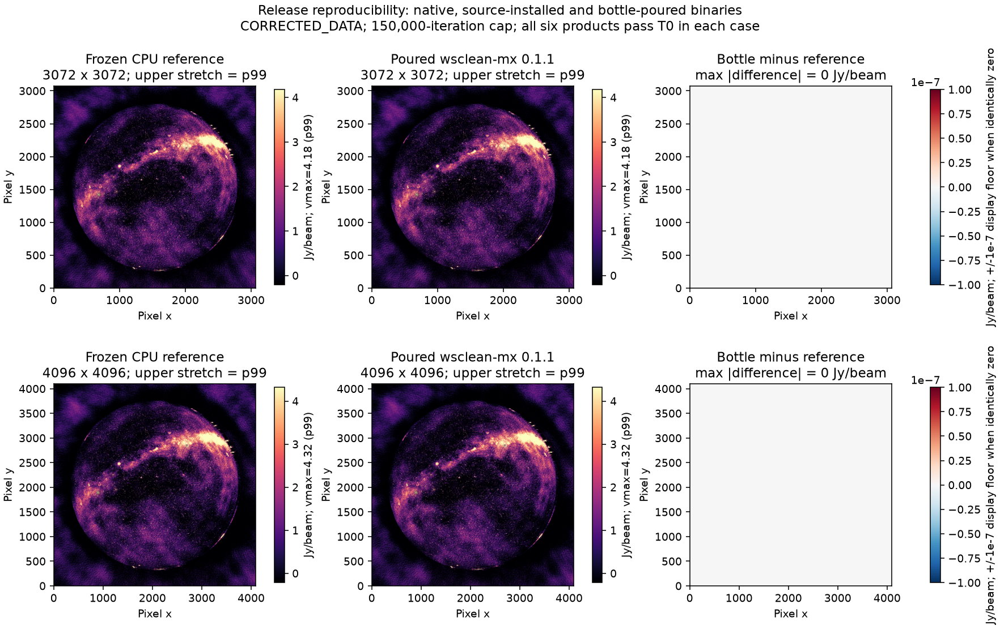

# wsclean-mx 0.1.1 release validation

**Status: release artifacts verified, 2026-10-24.** This is a
CPU-only packaging release from `release/0.1.1`. It is not a promotion of the
experimental Metal backend or a waiver of earlier scientific gate failures.

## User-visible contract

- Primary executable: `wsclean-mx`; no installed `wsclean` compatibility alias.
- MX release identity: `wsclean-mx version 0.1.1`.
- Upstream identity and FITS upstream-version metadata remain WSClean 3.7.
- Internal CMake target: `wsclean`. Optional MPI executable: `wsclean-mp`, not
  included in the Homebrew bottle and not runtime-tested in this release pass.
- CMake's `wsclean-mx` install component includes its threading runtime and uses
  a relative runtime search path. Tests read dyld's actual loaded-library path
  before and after relocating the installed component.
- Active MX runners reject a stale `build-mx/wsclean`; unmodified upstream and
  explicitly named historical snapshots keep their original filenames.

## Source and review

| Item | Evidence |
|---|---|
| Source base | Root `b81ae3d`; current verified CPU stack |
| Identity/install source commit | WSClean `e4bc27619f5e27ae74169f1454c497b7184c00b1` |
| Distributed identity patch | `patches/mx/wsclean/0056-Name-the-MX-executable-and-install-its-threading-run.patch` |
| Patch replay | All 78 patches reproduce the four expected component trees |
| Independent review | Initial rejection retained; corrected review passed with no security or logic findings |
| Python/linked regression driver | Final 263 Python tests passed; production numerical/provider/resource gates passed |
| Native WSClean | 160 passed, 4 existing skips, 869,917 assertions passed |
| Native Radler | Four executable suites and four build entries passed |

The initial review found an incomplete installed threading component and an
argparse collision for leading-dash snapshot names. Both received independent
RED/GREEN fixes. The parent also corrected the generated Python integration-test
executable path. The Homebrew name test and temporary-build-rpath test both
failed against the installed 0.1.0 package, as expected; both pass on the rebuilt
and clean-poured 0.1.1 package.

## Numerical acceptance

Frozen pre-rename CPU reference: `bench/bin/v011-baseline/wsclean`, SHA-256
`9c92740f73bc85ef9c72da1d7339795fd07d7382696a01608660e6e920270aaa`.

Each release-binary phase uses the protected 15-slot MS, **explicit
`-data-column CORRECTED_DATA`**, eight threads, a 150,000 iteration cap,
multiscale bias 0.8, gain 0.95, auto-threshold 0.5, auto-mask 3, local RMS,
Briggs 0 and a 10-degree horizon mask. Cases are 3072² at 2.7 arcmin/pixel and
4096² at 2 arcmin/pixel. Inputs are hashed before/after each phase. Every phase
must produce exactly the six expected FITS products and pass their data-array
T0 checks against the frozen baseline. Header history/version strings can differ.

This pass measures **release reproducibility**, not new performance gains.
The renamed native, final source-installed and clean bottle-poured executables
each pass all 12 product comparisons (six at each size): **36 final T0 comparisons**,
with unchanged protected-input contents and modes. The six products are dirty,
horizon mask, restored image, model, PSF and residual. Every case completes three
major cycles and reaches the final threshold before the cap: 93,854 components
at 3K and 97,873 at 4K. Compact receipts are in
[validation.json](bench/release-0.1.1/validation.json).

The image display is stretched to p99; the difference panels use a small display
floor because the measured differences are exactly zero. Numerical verdicts
come from the recorded gates, not visual inspection. Regenerate with
`plot_validation.py --artifacts <raw-release-directory>` using the project Python
environment. Five parser tests, also run with `python -O`, reject wrong phase,
size, path and product identities; the two initial plotting defects and binding
failure were corrected before generating this figure.
Raw receipts, logs and immutable case outputs live under
`bench/out/release-0.1.1-20261023-221629/`.

## Packaging and publication acceptance

The stable formula pins reviewed source commit
`f56963c15feec6711d2d962a14f76a272e4b3571`. Its downloaded archive SHA-256 is
`b340a78c5330408bcc52f3388ac8222d4848edbc8ee35e69d0e417252e597821`;
all 78 archived patch hashes match the reviewed source. A commit URL avoids a
circular checksum for the formula embedded in the archive. Later release commits
change packaging and evidence only, not the executable patch set.

The initial source-built package passed its name/runtime-path tests and all 12
T0 products. Strict linkage then exposed undeclared libdeflate/wcslib and
indirectly declared, directly linked GCC/readline runtimes. These are now explicit
runtime dependencies; corrected declarations pass `brew linkage --test --strict`.
The package was rebuilt to include the corrected dependency receipt. The initial
failure and successful pre-fix numerical runs remain recorded separately.

The generated bottle is `wsclean-mx-0.1.1.arm64_golden_gate.bottle.tar.gz`,
SHA-256 `06f99a01ad07020e7329c7d749692d8048e9db684f97c59b50fff0902f83f941`.
Homebrew generated `cellar: :any` metadata; relocation checks were not skipped.
The bottle is validated on Apple Silicon/macOS 27.0.1. Other supported macOS
versions may need a source build and are not covered by this bottle's test.

Before publication, a plain Homebrew install fetched the same hashed bottle over
loopback HTTP into a clean 0.1.1 keg (the old 0.1.0 keg was retained). Homebrew's
receipt confirms `poured_from_bottle: true`; name/version, strict linkage, relative
runtime paths and deep imaging all pass. The actual dyld trace loads the private
threading runtime and vendored casacore from the new keg. A 61-file manifest of
private and loaded external Mach-O files supports the subsequent public-download
readback check. `-mgpu` is explicitly refused by this CPU-only binary.

After publication, an empty-cache install from the public tap downloaded the
same bottle checksum and poured successfully. All 34 package Mach-O files match
the locally tested pour. Homebrew upgraded the external Python runtime from
3.15.0 to 3.15.0_1, so the complete 3K/4K campaign was repeated: **12 additional
T0 product checks passed**, with unchanged inputs. Name/version, runtime paths
and strict linkage pass again. See [public verification](bench/release-0.1.1/public-verification.json).
The four release assets, their published digests, release body, tag and public
tap recipe were read back and verified. This report does not
claim cross-prefix runtime testing beyond Homebrew's generated relocation checks
and the separate relocated native-component test.

## Limits retained

The previous strict 4K old/new T2 image checks and one-thread legacy T0 comparison
remain failed under their unchanged thresholds. These are separate from
incremental repeatability against the repaired current baseline. Four native
skips remain. No new claim is made for GPU hardware, MPI execution, every MS
layout, every observing mode, Linux packaging or all macOS versions. See the
[CPU correctness report](cpu-correctness-repairs-2026-10-22.md) and
[copy/masked-peak report](cpu-copy-and-masked-peak-2026-10-23.md).
